# Sleep Lab design system v2: "Instrument"

Status: **adopted**, 2026-10-29. This replaces v1 ("Kinetic Night", commit fe244a8).

What the user asked for, newest first:
- About System on a 5K display in desktop Chrome: "this looks so busy, don't know where to look, hard to read … Give this a total re-design like a professional app ui designer would. Make it an award winning design."
- "make it smooth and look expensive"
- "like the Kinetiq landing page, make it a story as you scroll down the page with animations" (the Today tab)

Taken together, the brief is to keep the Today scroll story and the premium feel, and make every screen calm, readable and clearly ordered on a 2560 px desktop and on an iPhone home-screen PWA.

The idea in one line: **Sleep Lab is a precision instrument for two sleepers.** It uses one typeface, neutral greys and a single signal colour, and colour only ever means something. Each screen has one reading in large type, with everything else quieter and pushed back.

---

## 0. The decision

Three directions were mocked as responsive static pages: Today and System, at 2560×1440, 1440×900 and 390×844 @2x, in dark, light and night. Each was judged on whether the eye lands in one second, craft and originality, 5K and iPhone behaviour, the scroll story, night mode, and whether it can be built with no new dependencies.

| Direction | Verdict |
|---|---|
| **INSTRUMENT** (winner) | Inter Tight only, neutral greys and one orange signal colour that appears only for the selection, the scrub cursor, the plan line and anything over a limit. This gives the strongest hierarchy of the three: at 2560 the thin-weight "75" is the only large object on the screen. "The night" is the best single moment in any of the mocks: a sticky-graphic scene with steps on the left and one cursor scrubbing both hypnograms, room °C against the plan, CO₂ and aircon ticks, with a live readout. Its *Tonight's plan* pane is a real product surface: a summary row, a clickable curve, phase keys, Starts/Target dials, and at ≥1760 px "What the aircon will do tonight". The phone System root opens on a *Tonight's plan* card. It has the most distinctive identity of the three and still reads as calm. |
| QUIET LUXURY | The most "Apple Settings" of the three, and very calm. Its Today, however, is a sequence of competent but generic slides; at 2560 several scenes are mostly empty space with small charts. **Grafted:** the System sub-pages listed in the desktop sidebar's second level, so there is one navigation column instead of two; the General pane (Appearance + People + Region) with number-free theme thumbnails, which also removes the 76-vs-75 bug; avatar-letter name fields that are obviously editable; the desktop Today "at a glance" row (Lights out · On the curve · CO₂ over 1,000 · Tonight). |
| EDITORIAL | The most beautiful typography (Newsreader serif headlines and ledes), and a strong feature-article Today. A second family and serif ledes make it read as a magazine rather than a tool, and its desktop Today ran 10.8 screens at 1440. **Grafted:** the rule that every chart's title is the finding; labels written directly on the chart with no legends; the CO₂ chart with the crossing time and the peak labelled on the line; the advice card with "Edit tonight's plan" and "Remind me at 22:30"; the collapsed aircon log; the quiet closing line; the "making the data agree" rules (§11); ghost data drawn at 32–38 %. |

### Fixes to the winner before it ships

1. **Ghost hypnograms.** The mock draws unrevealed stages as outlined boxes, which reads as noise (see `06-the-night-390-dark.png`). They become filled blocks at `--ghost` opacity with no stroke.
2. **System desktop navigation.** The mock adds an in-content category column beside the sidebar, which means two navigation columns. This is replaced by the sidebar's second level, taken from Quiet Luxury (`graft-sidebar-settings-2560.png`). Values such as "Door ajar" and "You, Erik" stay on the phone list only.
3. **Empty band on the desktop hero.** The gap between the person rows and the hypnogram strip gets the Quiet Luxury "at a glance" row. The hypnogram strip moves down to open "The night".
4. **Phone "The night" header.** "7 h 23 m in the dark." squeezes in beside "The night". It moves to its own line under the scene label.
5. **Aircon tick row.** On the phone the ticks collide with the 23:00 axis label. Ticks sit in their own 16 px row with an 8 px gap above the time axis.
6. **Light-mode signal.** `#d6480c` measures 3.95:1 on `#f4f3ef`, which fails for small text. It is now `#c2410c` (4.66:1 as text; white on it ≈ 4.8:1).
7. **Sparse Appearance pane at 2560.** Appearance, People and Region merge into one *General* pane.
8. **Numbers.** The three mocks disagree with each other: asleep 6h 41m / 7h 14m, CO₂ peak 1,245 / 1,257, crossing at 02:31 / 02:44. **None of the mock numbers is canonical.** The build takes every value from `packages/core` through the selectors in §11.

### Reference images (`docs/design/`)

| | | |
|---|---|---|
| 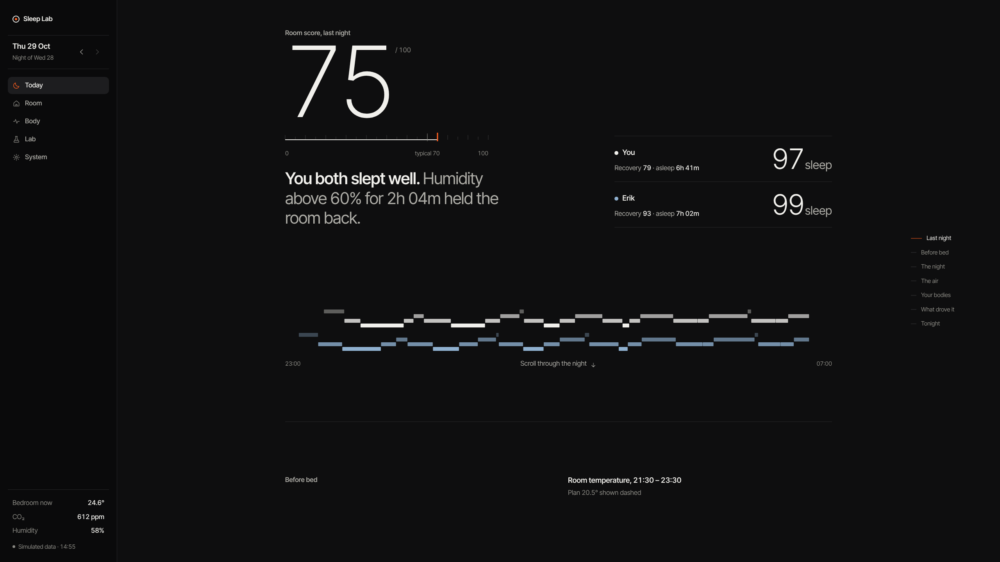 Today hero, 2560 dark | 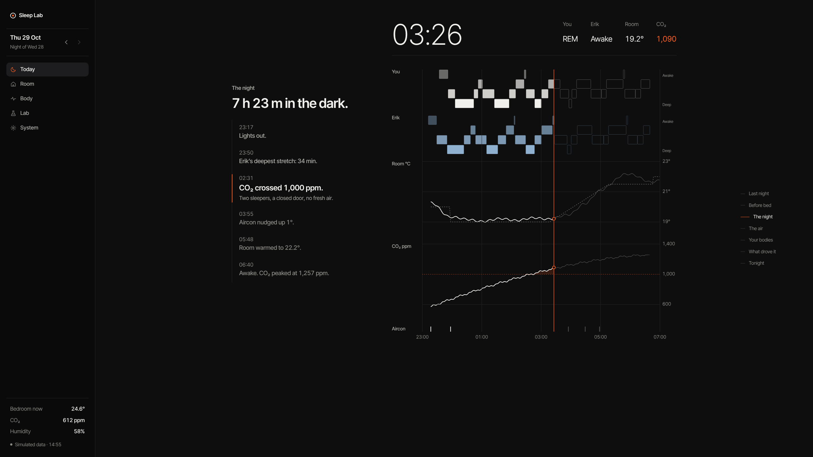 The night, 2560 (sticky graphic) | 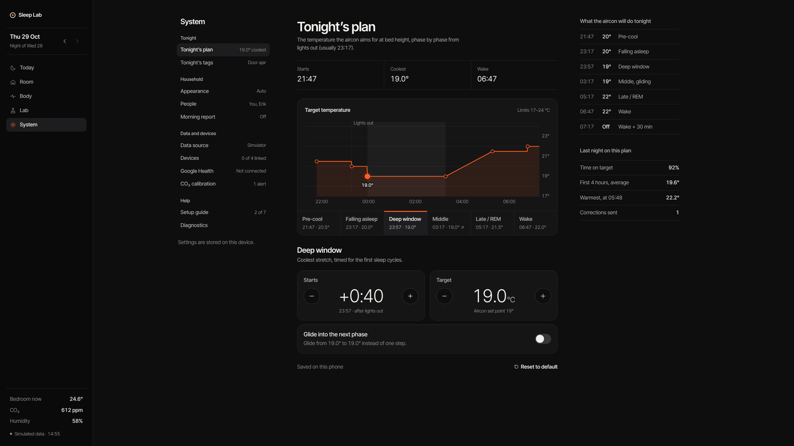 Tonight's plan, 2560 (with fix 2, the left list moves into the sidebar) |
| 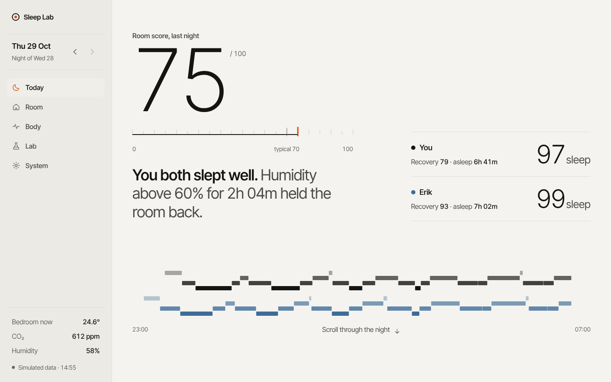 Today hero, 1440 light | 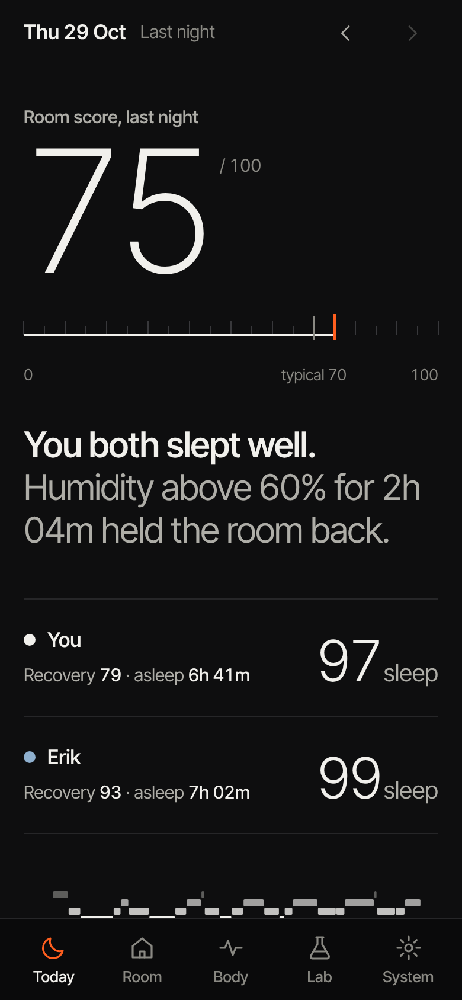 Today hero, iPhone | 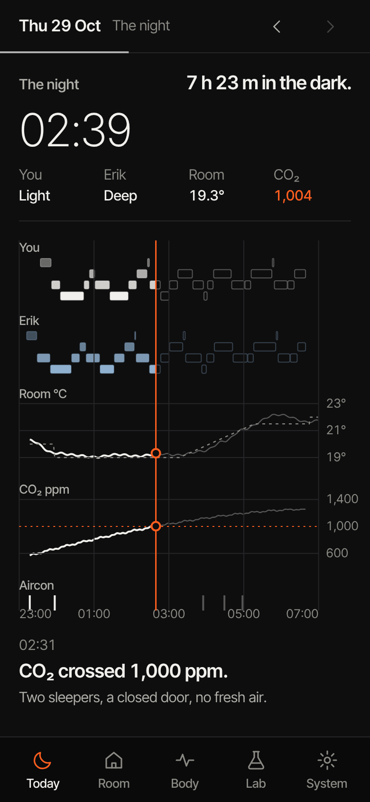 The night, iPhone (ghost style replaced by fix 1) |
| 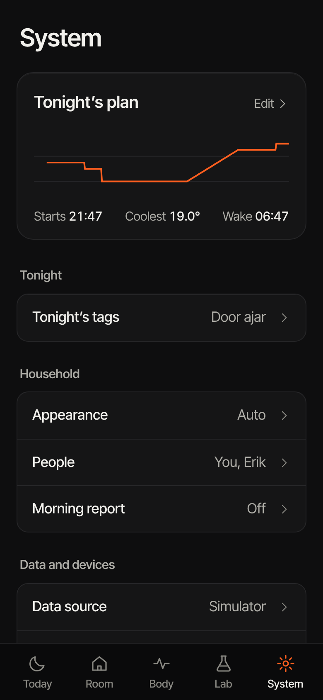 System root, iPhone | 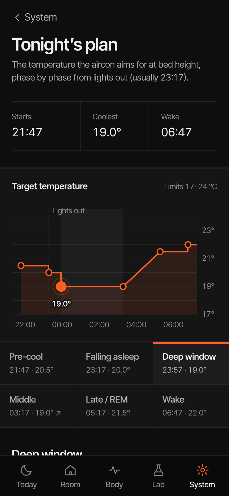 Tonight's plan, iPhone | 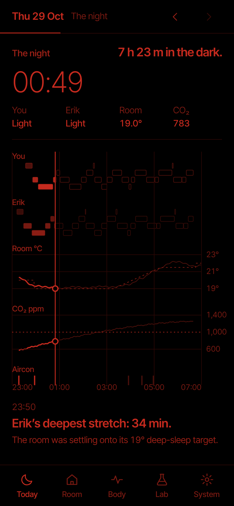 Night mode, The night |
| 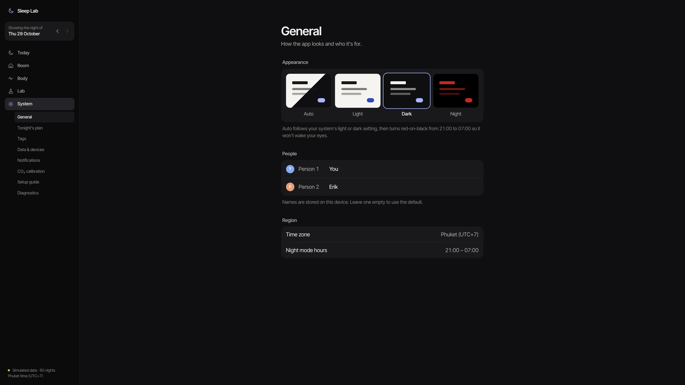 Graft: sidebar second level + General pane | 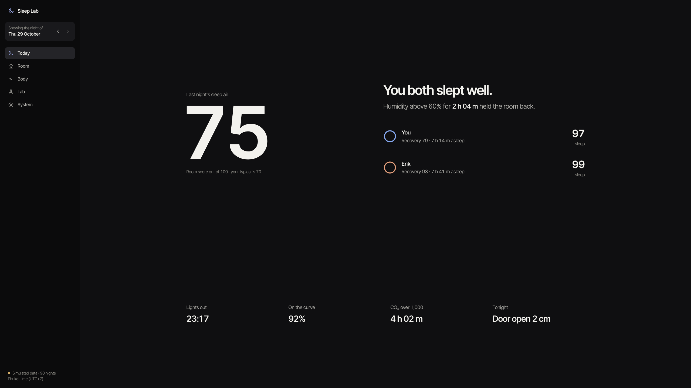 Graft: "at a glance" row (bottom of hero) | |

The winning mock's source is in `docs/design/mock/`: `base.css` holds the tokens and components, `shell.js` the scroll engine and number helpers, plus `today.html` and `system.html`. Open them in a browser and add `?theme=light|dark|night` to force a theme. The mock numbers are placeholders.

---

## 1. What changed from v1 and why

| v1 "Kinetic Night" | v2 "Instrument" | Why |
|---|---|---|
| A phone layout centred in a `max-width:1120px` box, with the floating pill tab bar on desktop too | At ≥1024 px a persistent sidebar, a 12-column content grid up to 1240/1400 px, and a 672 px reading column for settings. The phone keeps a solid bottom tab bar. | On a 5K screen more than half the width was dead, and the pill sat on top of charts. |
| 33 font sizes, nine of them ≤ 11 px; mono caps labels at 9.5–10.5 px | 7 roles; **13 px is the minimum on phone and 14 px on desktop**, axis ticks included; a size step at ≥1920 px | "hard to read". |
| Two families (Inter Tight + Geist Mono), five label voices, numbered eyebrows "01 APPEARANCE", dash kickers, 21 uppercase rules | One family. Sentence case everywhere. **Exactly one label style**: `.label`, secondary size, weight 560, `--text-2`. | Every element said "label", so nothing read as content. |
| One accent per chapter (violet, cyan, blue, amber, lime, mint), a rainbow progress bar, per-tile tints, 82 hex values | One signal colour per theme, used only for meaning. Series colours are fixed and few. | Colour stopped meaning anything, and series fought with UI accents. |
| Weights 750–800 at −0.075 em, gradient numerals, outlined chapter numerals, glows, star field, sky crossfade | Weights 250/300 for readings, 400 body, 560 labels, 600 titles. No gradients, glows, outlines or stars. | "busy", not "expensive". The luxury signal is restraint. |
| Cards nested in cards on every tab | Space and hairlines. A card only wraps a self-contained interactive object, and cards never nest. | Nothing grouped and nothing stood out. |
| Tab bar + sticky section JumpBar + in-card segmented controls (Lab: 3 chip rows on one card) | One navigation layer per level. JumpBars removed. A desktop "On this page" rail at ≥1760 px. Lab uses a sentence-builder. | Three stacked navigation layers. |
| The curve editor fourth on System, between Data source and Tags; dev telemetry next to preferences | *Tonight's plan* is its own page, reachable from Today › Tonight and first in System. Diagnostics, the setup guide and freshness each have their own page. | Progressive disclosure. The plan is the one thing you act on nightly. |
| 76 in theme previews vs 75 score; CO₂ 1,245 vs "peaked at 1,257"; 80 vs 90 nights unexplained | One selector per number, and the scrub clamps to the sleep window (§11) | Trust. |
| Fonts via `next/font/google` (§2 of v1) | `next/font/local`, Inter Tight only. Delete `GeistMono-latin-var.woff2`. | The Google loader breaks the Vercel build. |

Kept from v1: the Today story's chapter order and its pinned, finger-scrubbed "The night" chapter; the three themes, with automatic night mode from 21:00 to 07:00 ICT; the rule that motion uses only transform and opacity; reduced-motion support; and all chart token names (§3.4).

---

## 2. Principles

1. **One reading per screen.** Each screen opens with a single answer in large type: the score, the clock, the plan, "Right now". Everything after it is visibly secondary. Ask of every screen: where does the eye land in one second?
2. **Signal means something.** There is one signal colour per theme. It marks only the selected item, the scrub cursor, the plan line on the Tonight/plan charts, and states over a limit (CO₂ over 1,000 ppm, negative drivers, a drift alert). Everything else is greyscale ink.
3. **Sentence case, one label voice.** No uppercase, no letter-spaced labels, no eyebrows with numbers, no mono for labels.
4. **Space, not boxes.** Group with whitespace and one hairline. A card means "this is one object you can interact with", such as the plan instrument, a list group or a dial. Cards never nest.
5. **Show 3–4 things, then offer more.** Long tails go into "More analysis" rows, which open a sheet on the phone or a side panel / page on desktop.
6. **Desktop is a layout, not a stretched phone.** A sidebar, a grid, readable measures, and story scenes composed as two columns.
7. **Numbers agree everywhere.** There is one source per number, and it is rendered the same way on every surface.
8. **Calm motion.** Opacity plus a small rise, lines that draw in, a cursor that follows your finger. Nothing loops and nothing decorates the data.

---

## 3. Colour tokens

All colours live in `apps/web/styles/tokens.css` as custom properties on `:root[data-theme=…]`. Charts (inline SVG and Recharts) read **only** these variables.

### 3.1 Core tokens

| Token (v2 name) | Dark | Light | Night | Notes |
|---|---|---|---|---|
| `--bg` | `#0e0e0f` | `#f4f3ef` | `#000000` | Page. Dark is no longer pure black, so surfaces can sit one step above it. |
| `--rail` *(new)* | `#0a0a0b` | `#ebeae5` | `#000000` | Sidebar and phone tab bar, one step dimmer than the content (Linear's "inverted L"). |
| `--surface` | `#151516` | `#ffffff` | `#0c0201` | List groups, cards, sheets. |
| `--surface-2` | `#1d1d1f` | `#efeee9` | `#160403` | Selected sidebar row, segmented-control track, hover. |
| `--hairline` | `#262628` | `#dfddd6` | `#2a0705` | Dividers and row separators. Now solid, not alpha. |
| `--hairline-2` | `#38383b` | `#c9c7bf` | `#3d0a07` | Control borders, input outlines. |
| `--grid` | `#1c1c1e` | `#e8e6e0` | `#170302` | Chart gridlines, only at key values. |
| `--axis` | `#38383b` | `#c9c7bf` | `#2a0604` | Axis baselines. |
| `--text` | `#f1f0ec` (16.9:1) | `#141413` (16.6:1) | `#c42a1e` (3.7:1) | Primary text and "You" ink. |
| `--text-2` | `#aeada7` (8.6:1) | `#4c4b47` (7.9:1) | `#9a2016` (2.6:1) | Secondary text, labels, units. |
| `--muted` → also `--text-3` | `#8a8983` (5.5:1) | `#66655f` (5.3:1) | `#7a1a12` (2.0:1) | Captions and axis ticks. **Raised from v1** (`#6c6c68` failed AA). |
| `--signal` *(new)* | `#ff5f1f` (6.4:1) | `#c2410c` (4.7:1) | `#c42a1e` | The one colour. |
| `--signal-soft` *(new)* | `rgba(255,95,31,.16)` | `rgba(194,65,12,.12)` | `rgba(196,42,30,.18)` | Area above a limit, selected phase band. |
| `--on-accent` | `#120700` | `#ffffff` | `#000000` | Text on a signal fill. |
| `--accent` | `= --signal` | | | Kept as an alias so existing components still work. |
| `--ghost` | `.32` | `.30` | `.38` | Opacity of not-yet-revealed data (v1: .14/.18). |

Contrast figures are WCAG ratios against `--bg`. On `--surface` subtract about 0.3.

### 3.2 Data series

| Token | Dark | Light | Night | Use |
|---|---|---|---|---|
| `--person-a` (You) | `= --text` | `= --text` | `#c42a1e` | You are ink. Hypnograms, vitals, the You column. |
| `--person-b` (Erik) | `#8fb0cf` | `#3c6c98` | `#8a1d14` | Erik is steel blue, the only non-signal hue in the story. |
| `--temp` | `#7cbfb4` | `#1f7a70` | `#c42a1e` | Room °C, only where it shares a chart with another measure (Room/Lab). On a Today track by itself it uses `--text`. |
| `--co2` | `#d1b47c` | `#8f6a14` | `#9a2016` | CO₂, same rule. Above 1,000 ppm the line switches to `--signal`. |
| `--rh` | `#a8a0e0` | `#5a4fb8` | `#7a1a12` | Humidity (Room only). |
| `--setpoint` | `= --muted`, dashed 4/4 | | | Plan / setpoint. Always dashed, never coloured. On the Tonight and plan charts the plan is `--signal`. |
| `--outdoor` | `#c98f7a` | `#a6503a` | `#7a1a12` dashed | Outdoor vs bedroom. |
| `--dew` | `#b892c4` | `#8a4f99` | `#7a1a12` dotted | Dew point. |

Rule: a chart uses at most **two** hues. A third series must be `--muted`, dashed.

### 3.3 Stages, status, diverging

- **Sleep stages** use the person's colour, with opacity rising with depth. They are defined with `color-mix` so a person scope can override `--person`:
  - `--stage-deep: var(--person)` (100 %)
  - `--stage-light: color-mix(in srgb, var(--person) 85%, var(--bg))`
  - `--stage-rem: color-mix(in srgb, var(--person) 70%, var(--bg))`
  - `--stage-awake: color-mix(in srgb, var(--person) 40%, var(--bg))`
  - Row position carries the stage too: Awake on top, Deep at the bottom. The default `--person` is `--person-a`, and `.p-erik` sets it to `--person-b`.
  - In night mode the stages are fixed reds: `#c42a1e`, `#9a2016`, `#7a1a12`, `#4a0f09`.
- **Status:**
  - `--good: var(--muted)`, because "fine" is not colourful.
  - `--warn: var(--text-2)`.
  - `--serious` and `--critical: var(--signal)`.
  - `--good-text: var(--text-2)`, `--bad-text: var(--signal)`.
  - Bands: `--band-good: transparent`, `--band-warn: rgba(ink, .04)`, `--band-serious` and `--band-critical: var(--signal-soft)`.
- **Diverging** (driver bars, effect sizes, the correlation matrix): `--div-pos: var(--text)`, `--div-neg: var(--signal)`, `--div-mid: var(--surface-2)`.
- **Deltas against a person's own baseline are neutral.** They are written as text with an arrow and the typical value ("↓ 4 bpm vs typical 53"), never in red or green. Colour is used only where good or bad is unambiguous and the item is a score driver.

### 3.4 Token renames and removals (for the implementation PR)

- **Kept names** (charts keep working): `--bg --surface --surface-2 --text --text-2 --muted --hairline --hairline-2 --grid --axis --ring-track --on-accent --person-a --person-b --temp --co2 --rh --setpoint --dew --outdoor --good --warn --serious --critical --good-text --bad-text --band-* --stage-* --div-* --spark-line --spark-band --ghost --accent --font --font-num`.
- **New:** `--rail --signal --signal-soft --text-3` (an alias of `--muted`), `--person`.
- **Aliased, then deleted after the migration:**
  - `--ch-accent` and every `--ac-*` → `var(--signal)`. Chapters no longer change colour.
  - `--s1…--s8` → map to `--person-a`, `--person-b`, `--temp`, `--co2`, `--dew`, `--rh` and `--outdoor`, then replace each usage.
  - `--seq` → `--person-a`, `--seq-2` → `--person-b`.
- **Deleted:**
  - `--font-mono` (23 usages): replace with `--font` and `.num`. Only `.code` in Diagnostics uses `ui-monospace`.
  - `--sky-*`, `--star`, `--glow-o`, `--shine-o`, `--surface-glass` (the phone top bar uses `color-mix(in srgb, var(--bg) 92%, transparent)`; night mode uses a solid `--bg`), `--raise`.
  - The `.t-label`, `.t-micro`, `.t-hero`, `.t-mega` and `.t-big` classes.
- `--shadow`: dark `inset 0 1px 0 rgba(255,255,255,.04)`, light `0 1px 2px rgba(20,20,19,.05)`, night `none`.

### 3.5 Themes

- `data-theme` on `<html>` is `light`, `dark` or `night`. `lib/theme-boot.ts` sets it before first paint.
- **Auto** follows `prefers-color-scheme`, then forces `night` from 21:00 to 07:00 ICT (Asia/Bangkok).
- The `?theme=light|dark|night` query parameter forces a theme. It is used for screenshots and does not persist.
- **Night mode rules:**
  - Red only. No pixel brighter than `#c42a1e`, and G and B are both ≤ `0x30`.
  - No blur, no shadow, no translucency, no ambient motion.
  - Identity comes from lightness, dash pattern and direct labels, never from hue.
- **Contrast ceiling in night mode.** `#c42a1e` on black is 3.7:1, the hard maximum under the red-only rule, so 4.5:1 cannot be met. To compensate:
  - essential text in night mode is at least 17 px, so it passes the large-text-equivalent bar;
  - essential text always uses `--text`. `--text-2` and `--muted` are only for redundant information (units, ticks, captions that restate a labelled value);
  - primary buttons are outlined in `--text` rather than filled;
  - giant readings use `--text` at weight 300, not 250.

---

## 4. Typography

### 4.1 Family and loading

**Inter Tight only.** It is OFL, a variable 100–900 latin subset, and already in the repo at `apps/web/app/fonts/InterTight-latin-var.woff2`.

```ts
// app/layout.tsx
import localFont from 'next/font/local';
const sans = localFont({
  src: './fonts/InterTight-latin-var.woff2',
  weight: '100 900',
  variable: '--font-display',
  display: 'swap',
  fallback: ['system-ui', '-apple-system', 'Segoe UI', 'sans-serif'],
});
// <html className={sans.variable}>. Remove the Geist Mono loader and delete GeistMono-latin-var.woff2.
```

- **Never use `next/font/google`**: it breaks the Vercel build. If a family changes, download the latin variable woff2 from fonts.gstatic.com with curl into `app/fonts`, and use OFL fonts only.
- `--font: var(--font-display), system-ui, -apple-system, 'Segoe UI', sans-serif;` and `--font-num: var(--font)`.
- On `body`, set `font-feature-settings: 'tnum' 1, 'cv11' 1, 'ss03' 1`. Tabular figures are used everywhere, so counting numbers never jitter.
- `.code` (Diagnostics only, for env var names) uses `ui-monospace, 'SF Mono', Menlo, monospace` at the secondary size.

### 4.2 Scale

There are seven roles. Each is a custom property that steps at the breakpoints, so components only ever use the role.

| Role / class | Phone < 1024 | Desktop ≥ 1024 | Large ≥ 1920 | Weight · tracking · line height | Use |
|---|---|---|---|---|---|
| `--t-display` / `.display` | 96 | 136 | 168 | 250 (night 300) · −0.045em · 0.9 | One per screen: Today score (the hero uses 1.5×: 144 / 204 / 252), the scrubbed clock |
| `--t-num` / `.reading` | 48 | 60 | 72 | 300 · −0.03em · 1 | Instrument readings: "4h 02m", dial values, person scores, "+5" |
| `--t-title` / `.title` | 30 | 36 | 42 | 600 · −0.022em · 1.15 | Page titles, scene headlines ("Same curve. More air.") |
| `--t-head` / `.head` | 20 | 22 | 24 | 600 · −0.012em · 1.3 | Section and chart titles, the finding sentence |
| `--t-body` / `.body` | 17 | 18 | 19 | 400 · 0 · 1.5 | Body, list rows, step text |
| `--t-sec` / `.sec`, `.label` | 15 | 16 | 17 | 400 (`.label` 560) · 0 · 1.5 | Secondary text, **the one label style**, row values |
| `--t-cap` / `.cap` | 13 | 14 | 15 | 400 · 0 · 1.4 | Captions, axis ticks, footers. **The minimum. Nothing is smaller.** |

- **Units** (`.unit`): 0.42× the number at display and reading sizes, 0.6× at body and below, weight 400, `--text-2`, and a 0.08em gap before the unit, e.g. `24.6°`, `612 ppm`, `6h 41m`.
- **Hierarchy within a block** comes from size and the ink level (`--text` / `--text-2` / `--muted`), never from colour or uppercase.
- **Two-tone sentences** (ink, then `--text-2`) are allowed **once per screen**: the Today verdict ("You both slept well. Humidity above 60%…").
- **Measure:** body copy is at most 38rem (about 66 characters). Scene ledes are at most 30rem.
- **Weights in use:** 250, 300, 400, 560, 600. No 700 or above anywhere.

---

## 5. Layout, grid, breakpoints, navigation

### 5.1 Breakpoints

| Name | Width | Layout |
|---|---|---|
| phone | < 600 | Single column, 20 px gutter, top bar plus bottom tab bar |
| tablet | 600–1023 | Phone chrome. Content column centred, max 640 px. Theme thumbnails 4 across. |
| desktop | ≥ 1024 | Sidebar 264 px plus content grid. The phone top bar and tab bar are removed. |
| wide | ≥ 1440 | Today scenes get the full 5/12 + 7/12 split. Settings show a side column where defined. |
| xwide | ≥ 1760 | "On this page" rail on Today, Room, Body and Lab. Plan side column ("What the aircon will do tonight"). |
| large | ≥ 1920 | Type step (§4.2). Sidebar 300 px. Content max 1400 px. Gutters 64 px. |

Verify at 390×844, 430×932, 1024×768, 1440×900 and 2560×1440 (a 5K display at DPR 2).

### 5.2 Grid and spacing

- **Spacing** uses a 4/8 scale: `--sp-1…--sp-24` (4…96), plus `--section`, the space between sections: 64 phone / 112 desktop / 136 large.
- **Content grid on desktop:**
  - 12 columns with 32 px column gaps;
  - `max-width: 1240px` (1400 at ≥1920);
  - side padding `clamp(40px, 5vw, 96px)`;
  - centred in the space to the right of the sidebar.
- **Measures:**
  - reading column (settings detail, Body vitals list): **672 px**;
  - *Tonight's plan*: 832 px, plus a 300 px side column at ≥1760;
  - Today scenes: the full grid.
- **Radii:** `--r-s 10`, `--r-m 14`, `--r-l 20`, `--r-pill 999`. Only these four.

### 5.3 Navigation

There is one navigation layer per level, and never more than two levels.

**Phone (< 1024)**
- **Top bar**, sticky, 56 px:
  - date ("Thu 29 Oct", body size, 600), followed by the current chapter or page in `--text-2`;
  - previous/next night as 44 px icon buttons;
  - on Today, a 2 px neutral (`--text-2`) progress line along the bottom edge;
  - a hairline appears once the page scrolls;
  - background is `color-mix(--bg 92%)` with no blur. Night mode uses a solid background.
- **Drill-in pages** replace the date with a "‹ System" back link (44 px target) and a large page title below the bar.
- **Bottom tab bar**, solid `--rail`, top hairline:
  - 5 tabs (Today, Room, Body, Lab, System), each a 24 px icon over a 13 px sentence-case label, weight 500;
  - inactive `--muted`; active label `--text` with the active icon in `--signal`;
  - full-width strip, not a floating pill, padded for `env(safe-area-inset-bottom)`;
  - content reserves `calc(64px + safe-area)` at the bottom.

**Desktop (≥ 1024): sidebar ("inverted L")**
- `--rail` background, 264 / 300 px wide, sticky to the full viewport height, with a hairline on its right edge. From top to bottom:
  1. Wordmark: "Sleep Lab", 17/600, with a small signal-ring icon.
  2. Night picker: "Thu 29 Oct" (600) over "Night of Wed 28" (`--muted`), with ‹ › buttons. Keyboard: `[` and `]`.
  3. Five destinations as 40 px rows with an icon and label. The selected row has a `--surface-2` fill, `--text` label and signal icon.
  4. **Only on System**, the second level indented under System. Group labels (Tonight, Household, Data and devices, Help) are `.cap`; items are 36 px rows; the selected item has a `--surface-2` fill.
  5. Footer, pinned to the bottom: "Bedroom now 24.6° · CO₂ 612 ppm · Humidity 58%" as label/value rows, then "● Simulated data · 14:55" in `.cap`. These are live room readings, and in night mode this is the only chrome that changes.
- There is no JumpBar on any page. On long pages at ≥1760 a fixed right rail lists "On this page": `.cap` items, the current one in `--text` with a 16 px signal tick, the rest `--muted`.

---

## 6. Components

Each component lives in `components/ui.tsx` unless noted. Every interactive element has a hit area of at least 44×44 px.

| Component | Spec |
|---|---|
| **Page header** | `.title` plus an optional one-sentence `.sec` lede, max 38rem. No kicker, no badge. "Simulated" status lives in the sidebar footer (phone: System › Data & devices). |
| **List group** (the inset grouped list) | `--surface`, `--r-l`. Rows are 56 px tall on phone and 52 on desktop, padded 16/20. Each row has a title (body), optional subtitle (`.sec`), right-aligned value (`.sec`, `--text-2`) and an optional chevron. Separators are hairlines inset to the text. Group header is `.label` 12 px above; footer is `.cap` 8 px below. Icon tiles are not used. |
| **Featured card** | One per screen at most, e.g. the *Tonight's plan* card on the phone System root: `--surface`, `--r-l`, a title row with "Edit ›", a mini curve, then a three-figure strip. |
| **Segmented control** | A track in `--surface-2`, `--r-pill`, 40 px tall. The selected segment is `--surface` (dark) or white (light) with a 1 px `--hairline-2`, label `--text`; others are `--text-2`. One per card at most. |
| **Chip** (tags, phases on phone) | 44 px tall, `--r-pill`, 1 px `--hairline-2`, label body/`--text-2`. Selected: fill `--text`, label `--bg`, plus a 6 px signal dot. |
| **Switch** | 52×32. Off: track `--surface-2`. On: track `--text` (night: `--text` outline). The thumb moves with a 200 ms ease-out. |
| **Dial** (Starts / Target) | A `--surface` card with `.label` on top, then − and + (52 px round, 1 px `--hairline-2`) either side of a `.reading` value, with a single `.cap` meaning line underneath ("23:57 · after lights out"). **The value appears once.** |
| **Instrument keys** (plan phases) | Joined keys in a strip with 1 px dividers, 6 across, wrapping to 3×2 below 1760. Each key has a name (body 560) over "21:47 · 20.5°" (`.sec`). The selected key has a 3 px `--signal` bar on top and a `--surface-2` fill. A "glides" phase shows ↗. |
| **Input** | 48 px, `--r-m`, 1 px `--hairline-2`, label above. People rows: an avatar letter in the person colour, then "Person 1" (`.label`) above the editable name. The field is visibly bordered on focus and hover, so it reads as editable. |
| **Buttons** | 48 px, `--r-pill`, padded 0 20 px, label body 560. **Primary** is filled `--signal` with `--on-accent` (night: outlined in `--text`). **Secondary** is a 1 px `--hairline-2` outline. **Text** has no border, `--text`, and is underlined on hover. One primary per screen. |
| **Readout cells** | `.cap` caption over a value. Used for the "The night" live readout and the plan summary (Starts / Coolest / Wake). |
| **Stat** | A `.reading` value plus a `.sec` line of meaning ("above 1,000 ppm, 02:44 – 06:46"). |
| **Event list** | Time (`.sec`, tabular, 64 px column), then a short bold sentence (body 560) and an optional `.sec` detail. Used for before-bed, night steps and the aircon log. |
| **Status** | A 6 px dot (`--muted`; `--signal` for an alert) plus `.sec` text. **No pill outlines.** |
| **Disclosure** | A row with title, count ("7 commands") and chevron. It expands in place with a 250 ms height+opacity transition (immediate with reduced motion). |
| **Sheet / side panel** | Phone: a bottom sheet, `--surface`, `--r-l` top corners, a grabber, max 90svh, closed by swipe, Esc or the scrim. Desktop: a right-hand panel 480 px wide, or a full page for big drill-ins. Used for "More analysis", the Body algorithm notes and the Lab matrix. |
| **Advice card** | `--surface`, `--r-l`. A head-size sentence ("Crack the door 2 cm."), a `.sec` reason, then the primary button "Edit tonight's plan" and the text button "Remind me at 22:30". |
| **Theme thumbnails** | Four miniature windows (Auto split, Light, Dark, Night) with abstract bars. **No numbers.** The selected one has a 2 px `--text` ring. The label is below in body size. |
| **Skeletons** | `--surface-2` blocks with the final geometry, and no shimmer in night mode or with reduced motion. |

Icons stay as in v1: inline SVG, 24×24 viewBox, 1.7 stroke, round caps, `currentColor`. Use them in navigation and buttons only, never as decoration in list rows.

---

## 7. Chart guide

### 7.1 Shared rules

- **The title is the finding.** One sentence-case title (`.head`) per chart, e.g. "6 of the last 30 nights averaged over 1,000 ppm" or "CO₂ crossed 1,000 at 02:44". An optional `.cap` line underneath gives method or units. Never use a legend, an axis title and a caption all at once.
- **Label directly.** Series names sit at the line end or in the row header ("You", "Erik", "Room °C", "CO₂ ppm"). There are no legends.
- **Marks:**
  - Lines are 1.5 px (2 px for the hero series) with `vector-effect: non-scaling-stroke`.
  - Plan and setpoint lines are dashed 4/4 in `--muted`, except the Tonight and plan charts, where the plan is `--signal` and last night's actual is `--muted`.
  - Thresholds (1,000 ppm, 60 % RH) are dotted 2/3 lines in `--signal`, labelled at the right end. Only the area *beyond* the threshold is tinted, with `--signal-soft`.
  - Areas use 6 % ink fill, or none.
- **Axes:**
  - gridlines appear only at key values, in `--grid`, with no vertical gridlines except on the hour in the night tracks;
  - ticks are `.cap` (13/14/15 px) and tabular, in `--muted`;
  - time axes use clock time ("23:00, 01:00 … 07:00") with no seconds;
  - the y-axis sits on the right in story charts.
- **Scales:** every scale is clamped. Temperature charts use 17–24 °C on the plan and 18–23 °C in the night tracks. An out-of-range value (the 29° pre-cool start) is stated in the text, never as an "off scale" marker.
- **Ghost data** (not yet revealed by the scrub): filled marks at `--ghost` opacity with no stroke. Lines become a 1 px line at `--ghost`.
- **Readout dots:** a 7 px dot in `--bg` with a 2 px stroke in the series colour (signal at the cursor).
- **Tooltips** (Recharts, dense tabs): `--surface`, `--r-m`, 1 px `--hairline-2`, padding 10/12. Time in `.cap` above the values in `.sec` with tabular numerals. No shadow in night mode.
- **Animation:** draw-in only (stroke-dashoffset or a clip-path wipe), at most once per mount, and never when reduced motion is on.

### 7.2 Chart catalogue (where each mark comes from)

- **Hypnogram:** four rows, Awake on top, then REM, Light and Deep at the bottom. Blocks use the person's stage tokens (§3.3). Rows are 12 px on phone and 18 px on desktop with 4 px gaps. You and Erik are stacked, with a person label at the left.
- **Room °C vs plan:** an ink line, the plan dashed `--muted`, and the correction ticks below in a separate aircon row.
- **CO₂:** an ink line that turns `--signal` above 1,000 ppm, with the area above the threshold in `--signal-soft`. The crossing time and the peak are labelled on the line.
- **30-night bars:** `--muted` bars, nights over 1,000 in `--signal`, last night in `--text`, and a dotted 1,000 line.
- **Fresh-air meter:** a linear scale of 0–0.5 air changes per hour, a `--text` marker for last night, a `--signal` tick at "0.32 needed", and labels above.
- **Driver bars:** centred on zero, positive in `--text` and negative in `--signal`, with the value as a signed `.label` in a left column.
- **Score scale:** 0–100 ticks in `--hairline-2`, the filled portion in `--text`, a "typical 70" tick, and the current value as a 2 px signal tick.
- **Room/Body/Lab dense charts** follow the same rules with Recharts:
  - at most two hues plus a dashed `--muted` series;
  - no rainbow KPI tiles;
  - no speedometer gauges: the ventilation gauge becomes the fresh-air meter above.
- **Correlation matrix:** diverging `--div-neg` → `--div-mid` → `--div-pos`, with the value printed in each cell at ≥ 13 px. It lives in a drill-in.

---

## 8. Motion and the scroll story

### 8.1 Tokens

- `--ease: cubic-bezier(.2,.7,.2,1)` (reveals and settles), `--ease-io: cubic-bezier(.65,0,.35,1)` (sheets).
- Durations:
  - `--d-fast` 180 ms (hover, press);
  - `--d-base` 300 ms (controls, page fade);
  - `--d-reveal` 700 ms;
  - `--d-draw` 1,400 ms (lines);
  - `--d-count` 1,200 ms (the hero counts up; no other number counts).
- `--stagger` 80 ms, `--rise` 18 px.

### 8.2 Rules

- Animate transform and opacity only, apart from the stroke/clip draw-ins. Never animate layout properties.
- Reveals run once per element: `IntersectionObserver` at 15 % visibility, then opacity 0→1 and translateY 18 px→0.
- Pinning uses `position: sticky` only. Scroll progress is read in one rAF loop (`lib/motion/`, which keeps the v1 engine with its dwell zones) and written to CSS variables and SVG attributes. React never re-renders per frame.
- Page changes use a 300 ms opacity crossfade. The desktop sidebar does not move.
- **Reduced motion** (`prefers-reduced-motion: reduce`): everything renders in its final state. There are no rises, no draw-ins, no count-up and no bobbing scroll cue. The night scrub still works because it moves only with the finger, but cursor easing is removed.
- **Night mode:** no rise (opacity only), no count-up, no skeleton shimmer.

### 8.3 How the story works

- **Phone:** scenes stack in a single column. "The night" pins below the top bar for about 300svh. The scrub moves the clock, cursor, clip reveal and live readouts together, and the six step captions crossfade below the chart.
- **Desktop:** each scene is a 5/12 text column (sticky, vertically centred) beside a 7/12 visual. "The night" uses the *sticky graphic* pattern: the step list sits on the left, and the active step gets a 2 px signal bar and `--text` while the others are `--muted`. The graphic on the right is pinned, and the clock plus readout sit above it in a single row.
- **Holding each step.** The cursor is tied to scroll, but it holds on each step's exact minute for the first 35 % of that step (Editorial graft), so the readout matches the sentence while you read it.
- **Length budget:** the Today page is at most **8 viewport heights at 2560×1440** and at most 9 at 1440×900. "The night" takes about 3 of those.
- **Backdrop:** a flat `--bg`. There is no per-chapter glow, sky or star field.

---

## 9. Screens and information architecture

Every non-Today screen has the same anatomy:
1. a header (title plus one sentence);
2. **one hero** ("right now" or the key reading);
3. **three or four primary sections**;
4. "**More analysis**", a list group whose rows open a sheet on the phone or a page or side panel on desktop.

There are no JumpBars. On desktop at ≥1760, the "On this page" rail lists the primary sections.

### 9.1 Today (7 scenes plus a close)

| # | Scene | Phone | Desktop |
|---|---|---|---|
| 1 | **Last night** (verdict) | "Room score, last night" `.label`; **75** at hero display size with "/ 100" as a unit; the 0–100 scale with typical 70 marked; the verdict as a two-tone `.title` ("You both slept well. Humidity above 60% for 2h 04m held the room back."); You and Erik rows, each with a dot, name, "Recovery 79 · asleep …" and the sleep score at `.reading` with the unit "sleep". | Score and verdict in columns 1–6, people in columns 8–12. Below them, a hairline and the **"at a glance" row** of four readout cells (Lights out · On the curve · CO₂ over 1,000 · Tonight's advice), grafted from Quiet Luxury. |
| 2 | **Before bed** | "21:47" `.reading`; "The room was cool before you were in bed."; pre-cool chart (plan dashed); event list (aircon on, target reached, lights out). | Text left, chart and event list right. |
| 3 | **The night** (pinned) | Scene label, then "7 h 23 m in the dark." on its own line (fix 4); the clock at `.display`; a readout row (You stage · Erik stage · Room °C · CO₂, where CO₂ turns signal above 1,000); stacked tracks (You, Erik, Room °C vs plan, CO₂, aircon ticks); step caption. | Sticky graphic (§8.3). Six steps: lights out; Erik's deepest stretch; CO₂ crossing 1,000; the +1° correction; the room warming; wake and CO₂ peak. All times and values come from core. |
| 4 | **The air** | "4h 02m" `.reading` above 1,000 ppm; "Fresh at first, stale by morning."; the full-night CO₂ chart with the crossing and peak labelled; the fresh-air meter (0.17 of 0.32 needed); the 30-night bars. | Text left; CO₂ chart right; meter and bars beneath it in two columns. |
| 5 | **Your bodies** | A one-line finding ("Erik recovered better than usual. You, about as usual."); one stage bar per person; a You \| Erik table (sleep score, recovery, lowest HR, HRV, SpO₂, breathing), each shown against that person's typical with a neutral arrow; the link "Open Body ›". | Text left, table right. |
| 6 | **What drove it** | "+5 points" `.reading`; "The curve carried the night. Humidity cost the most."; Room and Bodies subtotals; 8 signed driver bars. | Text left, bars right. |
| 7 | **Tonight** | "Same curve. More air."; the advice card ("Crack the door 2 cm." · **Edit tonight's plan** → System › Tonight's plan · "Remind me at 22:30"); the plan chart (plan in signal, last night in `--muted`); tag chips for tonight; "Last night's aircon log · 7 commands" as a disclosure (collapsed on phone, open on desktop). | Text and advice left, chart and log right. |
| — | **Close** | "That was last night." `.head` in `--text-2`, with a text button "Back to top". | Same, centred under the grid. |

Today keeps v1's data wiring (`components/story/model.ts`). The work is presentation only.

### 9.2 Room

- **Hero, "Right now":** the CO₂ state as `.display` ("612 ppm"), followed by a one-line status ("Fresh. Door closed since 22:10.") and **one** piece of advice. Temperature and humidity appear as two readout cells beside or below it. The four rainbow KPI tiles are removed.
- **Primary sections:**
  - CO₂ ramp and forecast, with one segmented control for the forecast mode;
  - Setpoint vs actual;
  - Nights over 1,000 ppm (the 30-night bars, with ERV and fresh-air figures as a stat row).
- **More analysis** (each a drill-in):
  - Ventilation verdict (morning CO₂, fresh air, with ERV), shown as a meter rather than a gauge;
  - Fresh-air tracker;
  - Temperature × humidity;
  - 24-hour rhythm;
  - Nights off the temperature curve;
  - Room response;
  - Aircon duty and filter;
  - Events;
  - Shower impact;
  - Outdoor vs bedroom.

### 9.3 Body

- **Header:** "Body" plus a **You / Erik segmented control** in the header row (not a giant pill).
- **Hero:** the sleep score `.display`, with "6h 41m asleep · recovery 79" as `.sec`.
- **Primary sections:**
  - Last night: one stage row plus the hypnogram;
  - Vitals: a calm list in the reading column (HR nadir, HRV, SpO₂, breathing), each with value, neutral delta and "typical …";
  - Recovery trends: one chart, with the range set by a segmented control.
- **More analysis:**
  - Sleeping heart rate;
  - HRV through the night;
  - Last 14 nights;
  - Blood oxygen (mean, dips per hour);
  - Breathing;
  - Resting HR;
  - Steps (day before);
  - Skin temperature vs room.
- "Our sleep/wake vs Google's" (the algorithm notes) opens in an info **sheet** from an ⓘ button beside the hypnogram title.

### 9.4 Lab

- **Hero:** the strongest signal as one sentence plus its effect size ("Nights under 900 ppm: +6 min deep sleep · could be noise").
- **Primary sections:**
  - **Experiment board:** one question per row, as a forest plot with breathing room and the outcome picked from a single segmented control.
  - **Room × body:** a sentence-builder replaces the three chip rows. It reads "Compare **[Temperature ▾]** with **[Deep sleep ▾]**, **[same night ▾]**", where each bracket is a menu button (a sheet on the phone, a popover on desktop). The scatter title states r and its meaning ("No real link").
  - **By nightly mean CO₂.**
  - **Couple:** in sync, mirrored hypnograms, thermal compromise.
- **More analysis:** the 14-feature correlation matrix.
- Keep the honest copy: "Correlation, not causation" and "Mostly noise".
- The night count is "80 of 90 nights", with a short explanation of the excluded sick and away nights and sensor gaps. It links to Data & devices.

### 9.5 System (route `/settings`)

**Phone root.** A large "System" title, then:
1. a featured **Tonight's plan** card (mini curve, "Starts 21:47 · Coolest 19.0° · Wake 06:47", "Edit ›");
2. grouped lists whose rows each show a value and a chevron:

| Group | Row → page | What the page contains (everything from v1 is preserved) |
|---|---|---|
| — | **Tonight's plan** | Summary row (Starts / Coolest / Wake). The curve chart with the selected phase shaded and clickable nodes (limits 17–24 °C shown in the header). Six instrument keys (Pre-cool, Falling asleep, Deep window, Middle, Late / REM, Wake). The selected phase's **Starts** and **Target** dials and the "Glide into the next phase" switch. "Saved on this phone". **Reset to default**. At ≥1760 a side column adds "What the aircon will do tonight" (the command schedule worked out from the plan) and "Last night on this plan" (time on target, average for the first 4 hours, warmest, corrections sent). This page uses `CurveEditor.tsx` with the new presentation. |
| Tonight | **Tonight's tags** — value: the selected tags | Eight chips (Alcohol, Caffeine after 14:00, Late meal, Late exercise, Heavy duvet, Door ajar, Sick, Away) for "the night ending Fri 30 Oct", with the footer "Tags become filters and experiment arms in the Lab." |
| Household | **General** — value: "Auto · You, Erik" | Appearance: four thumbnails and the night-mode hours footer. People: two name fields, each with an avatar letter, plus "Leave empty to use the default". Region: time zone (Phuket UTC+7) and night-mode hours 21:00–07:00. |
| Household | **Morning report** — value: On/Off | The morning report notification toggle, with the push permission state. |
| Data and devices | **Data & devices** — value: "Simulator" | Source segmented control (Simulator / Supabase, with "not set up" when unconfigured). Nights: "90 · 1 Aug – 29 Oct, 80 with complete data". Freshness: last room reading, gaps in the last 24 h, Google Health last sync. Devices: Hub Mini, Meter Pro CO2, Aircon (Toshiba Carrier), the Fitbit bands and the camera, each with a detail line and a status dot. "Coming later: camera" is a row on this page. |
| Data and devices | **Google Health** — value: "Not connected" | The connect button, both bands, and what data is read. |
| Data and devices | **CO₂ calibration** — value: "1 alert" | Add an outdoor check, the history, and the drift warning row ("Night minimum below outdoor air: sensor drift"). |
| Help | **Setup guide** — value: "2 of 7" | A checklist of all 7 groups with every step from `SettingsScreen.tsx` `SETUP`, and progress for each group. |
| Help | **Diagnostics** | Seed / window (42 / 90), metrics compute time (ms, cached), app version, SwitchBot calls today (– / 5,000), webhook vs poll lag, the Supabase env var names `NEXT_PUBLIC_SUPABASE_URL` and `NEXT_PUBLIC_SUPABASE_ANON_KEY` (in `.code`), and Supabase sign-in state. |

**Desktop.**
- The sidebar shows System's second level: Tonight's plan, Tonight's tags, General, Morning report, Data & devices, Google Health, CO₂ calibration, Setup guide, Diagnostics.
- The detail pane is a 672 px column (832 for the plan), and Tonight's plan opens by default.
- There is no masonry and no second column of settings, so the eye reads one column top to bottom.

**Shared.**
- Each sub-page has its own URL (`/settings/plan`, `/settings/tags`, …), so Today's "Edit tonight's plan" can deep-link and the back button works.
- On the phone, the drill-in fades in over 300 ms and slides 24 px (fade only with reduced motion).

---

## 10. Accessibility

- **Contrast targets**, in light and dark:
  - body and primary text ≥ 7:1;
  - secondary text, labels, captions and axis ticks ≥ 4.5:1;
  - non-text marks (lines, focus rings, control borders) ≥ 3:1.
  - The token values in §3 meet these on `--bg`. Check again when anything sits on `--surface-2`.
  - Night mode is the documented exception (§3.5): the ceiling is 3.7:1, compensated by size.
- **Focus:** `:focus-visible` gives a 2 px `--text` outline at a 2 px offset with radius matching the element (night: `--text`). Never remove it. Do not draw focus with the signal colour, which is reserved for meaning.
- **Hit sizes:**
  - at least 44×44 for every control;
  - dial buttons are 52 px;
  - at least 8 px between adjacent targets;
  - list rows are 52–56 px.
- **Text:**
  - the minimum is 13 px on phone and 14 on desktop;
  - sizes are in px tokens but must survive 200 % browser zoom without horizontal scroll at 1024+;
  - no text is set in images.
- **Semantics:**
  - the sidebar and tab bar are `<nav aria-label="Main">`, with `aria-current="page"` on the current item;
  - System's second level is a nested list;
  - segmented controls use `role="radiogroup"`;
  - switches use `role="switch"`;
  - dials are `<button>`s with `aria-label`s ("Later start", "Warmer"), and the value sits in an `aria-live="polite"` region.
- **Charts:** every story chart has an `aria-label` that states the finding (the title sentence), plus a visually hidden table or summary for scrubbed values. Colour is never the only channel: thresholds are also dashed and labelled, and stages are also encoded by row position.
- **Motion:** honour `prefers-reduced-motion` (§8.2). Nothing flashes more than three times a second.
- **Keyboard:** `[` and `]` move between nights, the arrow keys move between plan phases, and Esc closes sheets and panels.

---

## 11. Making the data agree

- **Single selectors.** Each number below has exactly one function. Today, Room, Body, Lab, System and the theme previews all call it:
  - the room score;
  - per-person sleep score, recovery and time asleep;
  - lights out;
  - CO₂ crossing time, peak and minutes above 1,000;
  - time on the curve;
  - air changes per hour;
  - driver points.
  - These live in `components/story/model.ts` or `lib/analysis.ts`.
- **CO₂ peak:** the maximum within the sleep window (lights out → wake). The scrub readout clamps to the sleep window, so it can never show a value higher than the headline peak.
- **Nights:** "90 nights" is the simulator window. Lab's figure is "80 of 90 nights with complete data". The 10 excluded nights (sick, away, sensor gaps) are explained once, in Data & devices, and linked from Lab.
- **Theme previews contain no numbers.**
- **Formatting** goes through `lib/format.ts`:
  - durations as "7h 14m" (no spaces inside, a space between the parts);
  - thousands separators ("1,245 ppm");
  - temperatures with one decimal in readouts and none on axes ("19.0°" vs "19°");
  - 24-hour clock times.

---

## 12. Implementation notes and verification

- **No new npm dependencies.** Only `next`, `react`, `recharts` and `@supabase/supabase-js`. Fonts come only through `next/font/local`.
- **Suggested order:**
  1. tokens and type, keeping old names as aliases (§3.4);
  2. the Shell: sidebar, phone top bar and tab bar;
  3. System IA and its sub-routes;
  4. Today scenes;
  5. Room, Body and Lab anatomy;
  6. delete the aliases, `--font-mono`, JumpBar and the Geist Mono file.
- **Before merging:**
  - `cd apps/web && npx next build` passes;
  - if `packages/core` changed, `cd packages/core && npx vitest run` passes;
  - capture with Playwright against `next start` at 2560×1440 (DPR 1), 1440×900, 1024×768, and 390×844 and 430×932 (mobile, touch, DPR 2), in light, dark and night (`?theme=`), waiting until no `.sk` skeleton remains; then look at the shots.
- **Checks:**
  - no text under 13 px (grep the CSS for `font-size` values below the tokens);
  - no `text-transform: uppercase`;
  - no `--font-mono`;
  - no `--ac-*`;
  - night-mode pixels: G and B ≤ 0x30, R ≤ 0xC4;
  - the Today desktop page is ≤ 8 screens at 2560;
  - the same score and the same CO₂ peak on every surface.
