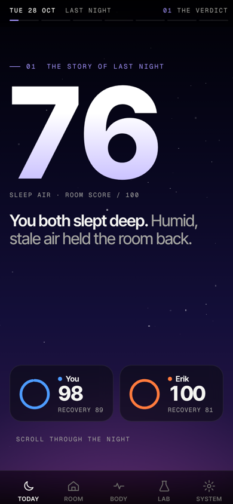
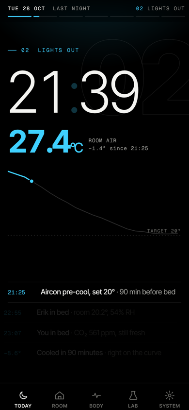
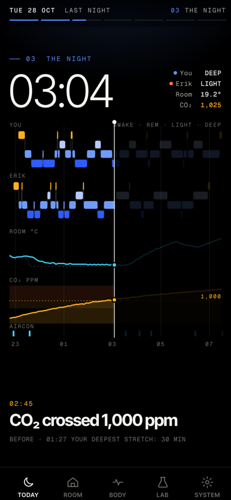
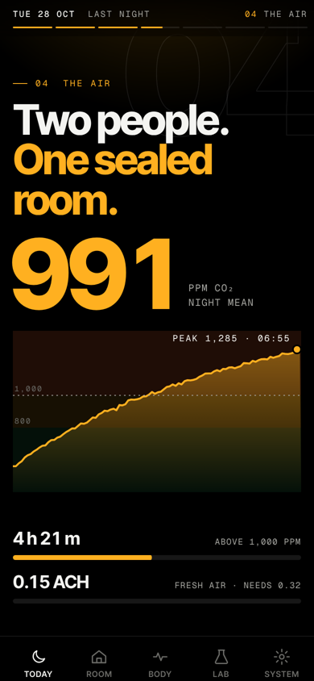
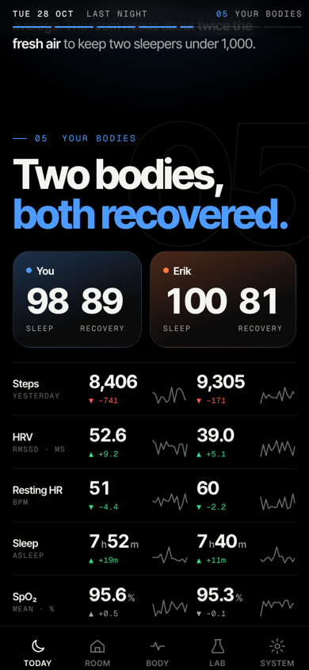
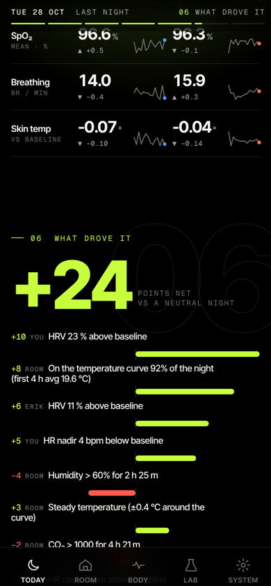
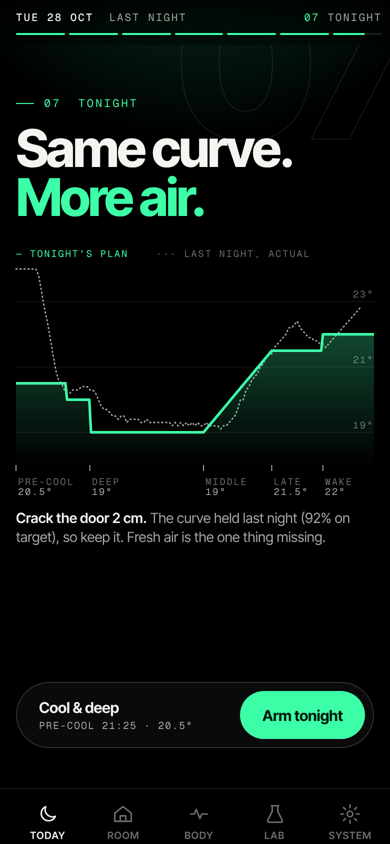
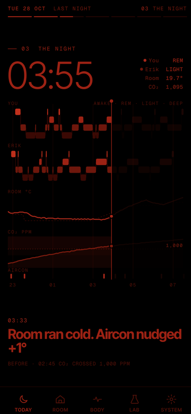
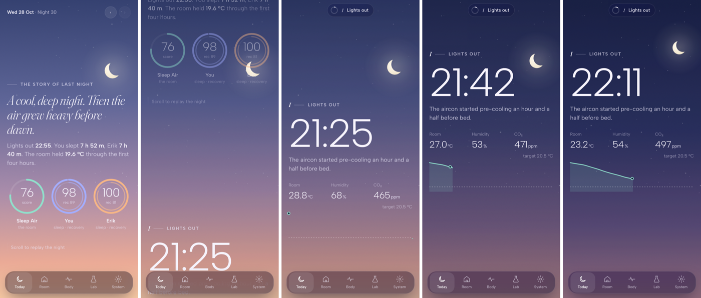

# Sleep Lab design system: "Kinetic Night"

Status: **adopted**, 2026-10-29. This replaces the ad-hoc dataviz styling in `apps/web/app/globals.css` and the card stack on the Today tab.

What the user asked for:
- "the ui is very basic, make it smooth and look expensive"
- "just like kinetiq landing page, make it a story as you scroll down the page with animations"

Reference: [kinetiq.xyz](https://kinetiq.xyz). On a phone it is a run of centred sections, each with one idea, one huge number and a short line under it. It uses frosted top and bottom bars, a mono face for labels, and stays quiet. We keep that pacing. The pinned, scroll-scrubbed parts come from Apple product pages and Whoop/Oura.

---

## 0. The decision

Three directions were mocked as working scroll stories. Each was captured as a 390×844 screenshot sequence in dark and night mode, plus light mode for two of them.

| Direction | Verdict |
|---|---|
| **KINETIC** (winner) | Closest to Kinetiq: one huge number per chapter, mono labels, a frosted header with chapter progress. All its numbers come from the real simulator (seed 42, night of 2026‑10‑28). Its pinned "The night" chapter is the best of the three: one cursor scrubs both hypnograms, room °C, CO₂ and the aircon ticks together, with live readouts and captions at real moments. It is the most legible at a 10‑second glance (76 fills the first screen) and the cheapest to run at 60 fps (flat black, no blur behind charts). |
| CALM CINEMATIC | Has the most atmosphere: the sky changes dusk → night → dawn as the clock moves, and the light theme is lovely. But the serif-italic display and cards on gradients read as "wellness app", not Kinetiq, and drawing 8 fixed gradient layers costs a lot on iPhone. **Grafted:** sky crossfade (reduced to 3 layers), floating glass pill tab bar, the compositor-only chart wipe, the ±(50 ppm + 5 %) CO₂ ribbon, the "In a sentence" insight block, the warm light theme, the caption list built from real data (including HR lows). |
| NOCTURNE | Has the finest typographic taste (Instrument Serif headlines) and the most careful night-mode rules. But its numbers were invented (84 / 71 don't exist in the data), its dark capture shows an unstyled light page, and serif + light weights lose the punch of Kinetiq's big figures. **Grafted:** in night mode giant numerals drop to `--text-2`; the ghost chart rises to 25 % in night mode; dwell zones at both ends of a scrub; a blurred twin glow under the score rings (off in night mode); the ivory "paper" light background. |

Fixes to the winner, from its own notes:
- In night mode the huge numerals were the brightest thing on screen; they now use `--text-2`.
- Night-mode deep sleep at `#3a0904` was invisible; it now uses the app's existing `#560f09`.
- The cursor's CO₂ readout must clamp to the sleep window (it showed 1,310 after wake while the headline peak said 1,285).

Reference screenshots (KINETIC mock, dark, real data):

| | | | |
|---|---|---|---|
|  Hero |  Lights out (pinned, scrubbed) |  The night (pinned, scrubbed) |  The air |
|  Your bodies |  What drove it |  Tonight |  Night mode, The night |

Graft reference (CALM, light): . Only the sky crossfade, the pill tab bar and the light palette are taken from it. Its typography is not.

---

## 1. Principles

1. **One idea per screen.** Each chapter has one headline, one huge number and at most one chart. If a screen needs two charts, it is two screens.
2. **The number is the hero.** Display figures run 96–212 px with tight tracking. Labels are tiny mono capitals. The size contrast between the two does the work that colour and boxes did before.
3. **Your finger is the playhead.** Time-based data (the night) is scrubbed by scroll, never auto-played. Momentum stays native. Pinning uses `position: sticky` only.
4. **Black is the canvas.** In dark mode depth comes from light (a radial glow per chapter, the sky at the top), not from shadows or stacked cards. Cards are kept for dense exploration (Room, Body, Lab, System).
5. **One accent per chapter.** Colour says where you are in the story. Series colours (You, Erik, °C, CO₂, stages) never change between chapters.
6. **Glance first, explore second.** The first screen answers "how did we sleep?" in under 10 seconds. The header segments jump to any chapter. Every story chart has a tap-through to its full explorable card.
7. **Night mode is a different instrument, not a dimmer.** It is red only and very dim, with no ambient motion. Scrubbing still works because it moves only with the finger.
8. **Motion confirms, it never decorates data.** Transform and opacity only. Nothing loops on top of data, and nothing blocks reading the final value.

---

## 2. Typography

Load both with `next/font/google` in `app/layout.tsx` and expose them as CSS variables:

```ts
import { Inter_Tight, Geist_Mono } from 'next/font/google';
const display = Inter_Tight({ subsets: ['latin'], weight: 'variable', variable: '--font-display', display: 'swap' }); // 100–900 axis; we use 300–800
const mono = Geist_Mono({ subsets: ['latin'], weight: ['400', '500', '600'], variable: '--font-mono', display: 'swap' });
// <html className={`${display.variable} ${mono.variable}`}>
```

Both families are in the installed Next 15.5 `next/font/google` font data (checked: `Inter Tight` has a 100–900 wght axis, and `Geist Mono` is listed). No package is needed.

- `--font: var(--font-display), system-ui, -apple-system, sans-serif` (body and UI)
- `--font-num: var(--font-display)` with `font-feature-settings: 'tnum' 1, 'lnum' 1, 'ss01' 1`. Every number uses the `.num` class so counting digits don't jump.

### Type scale (px at a 390 pt viewport)

| Token / class | Size / line-height | Weight | Tracking | Use |
|---|---|---|---|---|
| `.t-hero` | 212 / 0.78 (clamp 160–212 by `vw`) | 800 | −0.075em | The Sleep Air score on the hero |
| `.t-mega` | 120 / 0.82 | 800 | −0.06em | CO₂ mean, "+24" drivers net, outlined chapter numbers (stroke only) |
| `.t-clock` | 118 (Lights out) and 76 (The night) / 0.9 | 300 | −0.045em | Scrubbed clocks. Thin weight means time in motion |
| `.t-big` | 64 / 0.9 | 750 | −0.05em | Temperature readout (20.3 °C), person scores |
| `.t-h1` | 52 / 0.95 | 750 | −0.045em | Chapter headline ("Two people. One sealed room.") |
| `.t-h2` | 28 / 1.05 | 700 | −0.03em | Night captions, page titles on other tabs |
| `.t-h3` | 20 / 1.15 | 650 | −0.02em | Card titles in dense tabs |
| `.t-stat` | 23 / 1 | 700 | −0.02em | Vitals row values, table figures |
| `.t-body` | 17 / 1.4 | 450 | −0.01em | Lede and verdict sentences |
| `.t-small` | 13.5 / 1.4 | 450 | 0 | Notes and driver labels |
| `.t-label` | 10.5 / 1.3, mono, UPPERCASE | 500 | 0.14em | Kickers ("03 — THE NIGHT"), units, axis titles |
| `.t-micro` | 9.5 / 1.2, mono, UPPERCASE | 400 | 0.12em | Chart axis ticks, row labels in charts |

Rules:
- Units sit after the number in `.t-label` at 0.3–0.4 of the number's size, aligned to the baseline, in `--text-2`.
- Headlines use two tones: the first sentence in `--text`, the second in the chapter accent ("Two people. **One sealed room.**").
- The hero number uses a vertical gradient fill, `--text` to `--ac-hero` at 35 %. Night mode uses a flat `--text-2`.
- Never more than three type sizes on one screen besides the labels.

---

## 3. Colour tokens

The token **names** already used by charts stay the same (`--bg`, `--surface`, `--text`, `--text-2`, `--muted`, `--grid`, `--axis`, `--person-a`, `--person-b`, `--temp`, `--rh`, `--setpoint`, `--stage-*`, `--band-*`, `--good`, `--warn`, `--serious`, `--critical`, `--div-pos`, `--div-neg`, `--spark-*`). This keeps every Recharts and SVG chart working; only the values change. New tokens are marked ★.

Theme switching keeps the current mechanism (`data-theme` on `<html>`, `THEME_BOOT`, auto night 21:00–07:00 ICT).

### 3.1 Dark (the main look)

| Token | Value | Note |
|---|---|---|
| `--bg` | `#000000` | True black for OLED |
| `--surface` | `#0b0b0c` | Cards in dense tabs |
| `--surface-2` | `#141416` | Inputs, segmented track, hover |
| ★`--surface-glass` | `rgba(10,10,12,.82)` | Header and tab bar (with blur) |
| `--text` | `#f4f4f1` | |
| `--text-2` | `#a7a7a2` | |
| `--muted` | `#6c6c68` | |
| ★`--hairline` | `rgba(255,255,255,.09)` | Row dividers, card borders |
| ★`--hairline-2` | `rgba(255,255,255,.16)` | Focused borders, cursor track |
| `--border` | `var(--hairline)` | |
| `--grid` | `rgba(255,255,255,.07)` | Chart gridlines |
| `--axis` | `rgba(255,255,255,.16)` | |
| `--ring-track` | `rgba(255,255,255,.08)` | |
| `--accent` | `var(--ch-accent)` | ★ resolves per chapter (see 3.4) |
| `--on-accent` | `#000000` | Text on accent pills |
| `--person-a` | `#4d9bff` | You |
| `--person-b` | `#ff7a3d` | Erik |
| `--temp` | `#3fd0ff` | Room °C |
| ★`--co2` | `#ffb020` | CO₂ line |
| `--rh` | `#9085e9` | |
| `--setpoint` | `#c98500` | Aircon steps |
| `--dew` | `#d55181` | |
| `--outdoor` | `#e66767` | |
| `--stage-deep` | `#2f5bff` | |
| `--stage-light` | `#6f9bff` | |
| `--stage-rem` | `#b7c9ff` | |
| `--stage-awake` | `#ffb020` | |
| `--good` / `--good-text` | `#3ddc84` / `#5be39a` | |
| `--warn` | `#ffb020` | |
| `--serious` | `#ff8a4c` | |
| `--critical` / `--bad-text` | `#ff5a4e` / `#ff7a70` | |
| `--band-good` | `rgba(61,220,132,.05)` | CO₂ band washes |
| `--band-warn` | `rgba(255,176,32,.09)` | |
| `--band-serious` | `rgba(255,138,76,.12)` | |
| `--band-critical` | `rgba(255,90,78,.16)` | |
| `--div-pos` / `--div-neg` | `#c8ff3d` / `#ff5a4e` | Driver bars |
| `--spark-line` / `--spark-band` | `#6c6c68` / `rgba(255,255,255,.05)` | |
| ★`--ghost` | `.14` | Opacity of the unrevealed part of a scrubbed chart |
| ★`--glow-o` | `.22` | Chapter glow opacity |

### 3.2 Light ("ivory paper", grafted from Calm and Nocturne)

| Token | Value |
|---|---|
| `--bg` | `#f5f1e8` |
| `--surface` | `#fffdf9` |
| `--surface-2` | `#efe9dc` |
| `--surface-glass` | `rgba(250,247,240,.78)` |
| `--text` / `--text-2` / `--muted` | `#14131a` / `#55525e` / `#8b8794` |
| `--hairline` / `--hairline-2` | `rgba(20,19,26,.09)` / `rgba(20,19,26,.16)` |
| `--grid` / `--axis` / `--ring-track` | `rgba(20,19,26,.07)` / `rgba(20,19,26,.18)` / `rgba(20,19,26,.08)` |
| `--on-accent` | `#ffffff` |
| `--person-a` / `--person-b` | `#2f6fe0` / `#d9622a` |
| `--temp` / `--co2` | `#0a8fc0` / `#c77d00` |
| `--rh` / `--setpoint` / `--dew` / `--outdoor` | `#6250d6` / `#a86d00` / `#c2457a` / `#d03b3b` |
| `--stage-deep` / `-light` / `-rem` / `-awake` | `#1d3fc4` / `#4f7fe8` / `#9db6f2` / `#d99400` |
| `--good` / `--good-text` | `#1f9e5a` / `#13703f` |
| `--warn` / `--serious` / `--critical` / `--bad-text` | `#d99400` / `#e0763f` / `#d03b3b` / `#b02a2a` |
| `--band-good/warn/serious/critical` | `rgba(31,158,90,.07)` / `rgba(217,148,0,.10)` / `rgba(224,118,63,.11)` / `rgba(208,59,59,.12)` |
| `--div-pos` / `--div-neg` | `#5a9e00` / `#d03b3b` |
| `--spark-line` / `--spark-band` | `#8b8794` / `rgba(20,19,26,.05)` |
| `--ghost` / `--glow-o` | `.18` / `.35` (glows are pastel washes on ivory) |

Light chapter accents use the "darker step" column in 3.4. The hero sky becomes a pale dawn (see 3.5).

### 3.3 Night (red on black, unchanged values plus additions)

Keep **every existing night value** in `globals.css` (`--bg #000`, `--text #a3241a`, `--text-2 #7d1a12`, `--muted #5c130d`, stages `#560f09 / #7a1a11 / #8f1f16 / #b0261b`, the band reds, and so on). Add:

| Token | Value | Note |
|---|---|---|
| `--surface-glass` | `#050000` | Solid, no blur |
| `--hairline` / `--hairline-2` | `rgba(150,24,12,.18)` / `rgba(150,24,12,.30)` | |
| `--person-a` / `--person-b` | `#a3241a` / `#6e170f` | Told apart by lightness, plus Erik is dashed in line charts |
| `--temp` / `--co2` | `#9c2219` / `#7d1a12` | CO₂ is also told apart by its band wash |
| `--ch-accent` (all chapters) | `#a3241a` | Every chapter accent collapses to one red |
| `--div-pos` / `--div-neg` | `#7d1a12` / `#b0261b` | Gains are dim, losses bright |
| `--ghost` | `.25` | Grafted from Nocturne, keeps the ghost legible |
| `--glow-o` | `0` | No glows, sky, stars, gradients or shine |
| ★`--num-color` | `var(--text-2)` | Giant numerals (`.t-hero`, `.t-mega`, `.t-clock`) use this |

In the other themes `--num-color: var(--text)`. Night-mode audit rule: no pixel may exceed sRGB `#c42a1e`, and green and blue channels must stay ≤ `0x30`. Check this with the screenshot script (section 11).

### 3.4 Chapter accents (`--ch-accent`, set by `<Chapter accent>`)

| Chapter | Dark | Light | Night |
|---|---|---|---|
| 01 Verdict | `#a495ff` violet | `#5b4bd6` | `#a3241a` |
| 02 Lights out | `#3fd0ff` cyan (= `--temp`) | `#0a8fc0` | ″ |
| 03 The night | `#5b8cff` | `#2f5fe0` | ″ |
| 04 The air | `#ffb020` amber (= `--co2`) | `#c77d00` | ″ |
| 05 Your bodies | `--text` (person colours do the work) | `--text` | ″ |
| 06 What drove it | `#c8ff3d` lime / `#ff5a4e` | `#5a9e00` / `#d03b3b` | ″ |
| 07 Tonight | `#3dffa8` mint | `#0f9e66` | ″ |

The header kicker, progress-segment fill, outlined chapter number, chapter glow and primary button all read `--ch-accent`. The accent swaps with a 0.9 s crossfade, driven by the active chapter.

### 3.5 Sky (grafted from Calm, cut down to 3 layers)

This is a fixed `<div class="sky">` behind the Today story, made of three stacked gradient layers. Only `opacity` changes, and at most two layers are non-zero at a time.

| Layer | Dark | Light |
|---|---|---|
| `--sky-dusk` | `linear-gradient(180deg,#1a1233 0%,#2c1a3f 45%,#000 100%)` plus radial `#ff9a5a` at 12 % on the horizon | `linear-gradient(180deg,#f7e3d3 0%,#efe2ef 50%,var(--bg) 100%)` |
| `--sky-mid` | `linear-gradient(180deg,#05071a 0%,#000 70%)` plus a star field (2 SVG layers, 40 and 70 dots, parallax 0.06 and 0.12) | `linear-gradient(180deg,#e6e9f5 0%,var(--bg) 70%)`, no stars |
| `--sky-dawn` | `linear-gradient(180deg,#071a24 0%,#0e2a33 40%,#000 100%)` plus radial teal at 10 % | `linear-gradient(180deg,#e2f0ea 0%,var(--bg) 70%)` |

Mapping: Verdict = dusk. Lights out goes dusk → mid. The night: mid until the cursor passes 04:30, then mid → dawn up to wake. The air through What drove it: the sky fades to 0 (plain `--bg`, data-first). Tonight: dusk again at 60 %. Night mode: `.sky { display: none }`.

---

## 4. Surfaces, elevation, radii, borders, blur

- **No shadows in dark or night.** Elevation is a 1 px `--hairline` border plus, for raised items only, a 1 px inner top highlight `inset 0 1px 0 rgba(255,255,255,.06)`.
- **Light shadows** (Calm's three soft layers): `--shadow: 0 1px 1px rgba(20,19,26,.04), 0 6px 16px -6px rgba(20,19,26,.08), 0 28px 56px -18px rgba(20,19,26,.14)`.
- **Radii:** `--r-xl 28px` (sheets, hero person cards), `--r-lg 22px` (cards), `--r-md 14px` (tiles, inner blocks), `--r-sm 10px` (chips, inputs), `--r-pill 999px`. Chart bars use 2.5 px corners.
- **Glass:** only on the fixed header, the tab bar and sheets: `background: var(--surface-glass); backdrop-filter: blur(20px) saturate(1.4); -webkit-backdrop-filter: same`. Never put glass over a scrolling chart. Night mode: no blur.
- **Person cards** (Bodies chapter, Body tab): `--surface`, plus a corner wash `radial-gradient(120% 90% at 100% 0%, color-mix(in oklab, var(--person-x) 26%, transparent), transparent 60%)`. No wash in night mode.
- **Chapter glow:** one absolutely positioned `div.glow` per chapter, `radial-gradient(60% 40% at 30% 20%, var(--ch-accent), transparent 70%)` at `opacity: var(--glow-o)`. It is a pre-blurred gradient, not `filter: blur`.
- **Outlined chapter number:** `.t-mega` at 180 px, `color: transparent; -webkit-text-stroke: 1px var(--hairline-2)`, top-right, with parallax 0.3×. Hidden in night mode.
- **Noise:** a 5 % monochrome noise PNG (2 KB, 128 px tile) over the sky to stop OLED gradient banding. Dark and light only.

---

## 5. Spacing and layout

- 4 px base grid. Tokens: `--sp-1 4`, `--sp-2 8`, `--sp-3 12`, `--sp-4 16`, `--sp-5 20`, `--sp-6 24`, `--sp-8 32`, `--sp-10 40`, `--sp-12 48`, `--sp-16 64`, `--sp-24 96`.
- Side gutter is **16 px**. Content max-width is 560 px, centred. Tablet and desktop keep the existing `.stack.two` grid for the dense tabs.
- Chapter padding: 96 px top (it clears the header), 112 px bottom (it clears the tab bar).
- Safe areas: header `padding-top: max(10px, env(safe-area-inset-top))`, tab bar `bottom: max(10px, env(safe-area-inset-bottom))`.
- Vertical rhythm inside a chapter: kicker → 16 → headline → 24 → number → 24 → chart → 16 → caption.

---

## 6. Icon set (inline SVG, 24×24 viewBox, stroke 1.7, round caps and joins, `currentColor`)

Put these in `components/icons.tsx` as `<Icon name="…" size={20} />`. Draw the paths in the same style as the existing TabBar icons.

- Tabs: `moon` (Today), `house` (Room), `pulse` (Body), `flask` (Lab), `gear` (System)
- Navigation: `chevron-left`, `chevron-right`, `chevron-down`, `arrow-up-right` (open the full card), `close`, `calendar`
- Data: `thermometer`, `droplet` (RH), `co2` (a "CO₂" glyph in a cloud outline), `wind` (fresh air / ACH), `snowflake` (aircon cool), `fan`, `door`, `shower`, `bed`, `heart`, `lungs` (breathing), `o2` (SpO₂), `footprints` (steps), `zzz` (sleep), `sunrise` (wake), `sunset` (lights out)
- Status: `check`, `alert`, `info`, `sparkle` (insight), `play` (arm tonight), `edit`, `refresh`
- Event glyphs keep `EventGlyph` in `NightStrip.tsx`. Restyle them to 1.4 stroke `--text-2`.

The active tab icon gets `--ch-accent` plus a 4 px dot underneath (`moon` filled at 15 % on Today).

---

## 7. Components inventory

All in `components/ui.tsx` unless noted. Props stay compatible with today's `Card`, `Segmented`, `Legend`, `Placeholder` and `TableView` call sites.

| Component | Spec |
|---|---|
| **Card** | `--surface`, 1 px `--hairline`, `--r-lg`, padding 18 px, `--shadow` (light only). Header: `.t-label` kicker (optional), `.t-h3` title, `.t-small --text-2` sub, `meta` slot on the right. New `reveal` prop (default true) wraps it in `<Reveal>`. New `href` prop shows `arrow-up-right` and makes the title a link. |
| **Chapter** (`components/story/Chapter.tsx`) | `<Chapter id n title accent sky pinned={vh?} onProgress?>`. Renders `<section data-chapter style="--ch-accent:…; height: pinned ? pinned*100+'svh' : auto">` with a `.pin` child (`position: sticky; top: 0; height: 100svh; overflow: hidden`). Registers with the scroll engine, writes `--p` (0–1) on the section and calls `onProgress(p)` for imperative drawing. Includes the glow and the outlined number. |
| **SectionHeader** | Kicker `— 03  THE NIGHT` (mono, `--ch-accent`, a 16 px leading rule) plus `.t-h1` two-tone headline. Lines reveal with a mask (each line in `overflow: hidden`, inner `translateY(100%) → 0`, 90 ms stagger). |
| **MetricTile** | Label (`.t-label`), value (`.t-stat` or `.t-big`), unit, optional `DeltaChip`, optional `Sparkline` (46×26). Variants: `row` (vitals table row, hairline separated) and `tile` (2-up grid). |
| **DeltaChip** | Mono 10 px, padding 2 × 6, `--r-pill`, a ▲/▼ glyph. Tones: good is `--good-text` on a 10 % wash, bad is `--bad-text` on a 10 % wash, neutral is `--text-2`. Night: no wash, glyph and text only. |
| **ScoreRing** | Keep the API. 7 px outer (score) and 4 px inner (recovery) on `--ring-track`, round caps, a gradient stroke (person colour → 70 % lighter), and Nocturne's blurred twin underneath (same arc, `filter: blur(6px)`, opacity .5) as a **pre-rendered** SVG `feGaussianBlur` drawn once. No twin in night mode. Draws in with `stroke-dashoffset` over 1.6 s `--ease-out`, centre number counts up. |
| **Segmented** | Track `--surface-2`, `--r-pill`, 3 px inset. The selected thumb is an absolutely positioned pill that slides with `transform` (280 ms `--ease-out`). Labels are 13 px, weight 600. |
| **TabBar** | Floating pill (from Calm): `position: fixed; left: 12px; right: 12px; bottom: max(10px, safe-area)`, height 62, `--r-pill`, glass. Five items, icon 22 + mono 9.5 label. The active item has a soft `--surface-2` capsule behind it that slides between tabs (transform). `--tabbar-h: 84px` reserved below the content. |
| **StoryHeader** (`components/story/StoryHeader.tsx`) | Fixed glass bar on Today: date (`TUE 28 OCT`) · `LAST NIGHT` · active chapter `03 THE NIGHT` in `--ch-accent`. Below it, **7 progress segments** (2 px, 4 px gap). Each fills with `scaleX(p)` of its chapter, and tapping one scrolls to that chapter (`scrollIntoView({behavior: 'smooth'})`, instant under reduced motion). Prev/next night chevrons (DateNav's job) sit at the far right. |
| **Sheet** | Bottom sheet for drill-down: glass, `--r-xl` top corners, a 36×4 grabber, slides with `translateY` (420 ms `--ease-out`), with a scrim at 50 % black (night: 80 %). Used for score focus (tap a ring → drivers), night-strip details and the date picker. Use the View Transitions API when present (`document.startViewTransition`), with a plain transform fallback. |
| **Skeleton** | Replaces `Placeholder` and `Loading`. A `--surface-2` block with a shimmer (a 1.4 s linear `translateX` gradient sweep at 6 % white). Night mode: no shimmer, static `--surface`. Keep the shape of the final content: a ring skeleton for rings, a 3-line headline skeleton. The worker-progress text sits in `.t-label` under the hero skeleton ("ANALYSING NIGHT 23 OF 30"). |
| **Toggle** | 46×28 track `--surface-2`, a 22 px knob, on = `--ch-accent` track with a `--on-accent` knob, 220 ms `--ease-out` transform. It replaces the visible checkbox styling (the native input stays for a11y). |
| **Button** | `primary`: 48 px tall, `--r-pill`, `--ch-accent` background, `--on-accent` 15 px/650 label, plus a 1.2 s diagonal shine on reveal (off in night mode). `ghost`: hairline border, `--text`. `quiet`: text only, mono label. Pressed state: `scale(.97)` over 120 ms. |
| **Reveal** (`components/story/Reveal.tsx`) | See section 9. |
| **CountUp**, **DrawPath**, **ScrubWipe**, **Cursor** | See section 9. |
| **Legend / Key / TableView / StatusDot** | Keep the APIs. Legend uses mono 10 px, keys are 10×3 bars or 6 px dots. |

---

## 8. Chart style guide

### 8.1 Shared

- Line widths: 2.2 px primary, 1.5 px secondary, 1 px reference. Round joins and caps.
- Gridlines: horizontal only, `--grid`, 1 px, at most 3 lines. No y-axis line. The x-axis is ticks only (`.t-micro`, `--muted`).
- Reference lines (target °C, 1,000 ppm) are dashed `3 4` in `--text-2` at 60 %, with a right-aligned `.t-micro` label ("TARGET 20°", "1,000").
- Area fills: a vertical gradient of the series colour, 35 % → 0 %. Night mode: 12 % flat.
- **CO₂** always shows the fixed bands as full-width washes (`--band-*`), plus Calm's tolerance ribbon ±(50 ppm + 5 %) at 12 % of `--co2`. Above 1,000 the line is drawn in `--co2`; below it, in `--text-2` (a two-segment `<linearGradient>` with a hard stop at the 1,000 y-position).
- **Hypnogram:** four lanes (awake top → deep bottom), segments are `rect`s with 2.5 px corners, joined by 1 px `--hairline-2` verticals. Couples are mirrored on one shared axis (You above, Erik below) in the story; the dense tab keeps two stacked lanes.
- Person identity: colour in dark and light; in night mode lightness plus **Erik dashed `4 3`**.
- Tooltips: a glass chip, mono 11 px, a 1 px `--hairline-2` vertical crosshair, values in `.t-stat` at 15 px. They follow the touch point and never cover the finger (offset 24 px above).
- Text is never coloured by series. Use a key dot next to the label instead.

### 8.2 Recharts (dense tabs)

- Create one `chartTheme` in `components/charts/common.tsx` and spread it into every `<XAxis>`, `<YAxis>`, `<CartesianGrid>` and `<Tooltip>` (`axisLine={false}`, `tickLine={false}`, `tick={{ fill: 'var(--muted)', fontSize: 9.5, fontFamily: 'var(--font-mono)' }}`, `vertical={false}`, `stroke: var(--grid)`).
- Animation: `isAnimationActive={motionOK && revealed}` with `animationDuration={900}` and `animationEasing="ease-out"`. Mount the chart inside `<Reveal>` so it animates when it enters the viewport, not on page load. In night mode or with reduced motion, `isAnimationActive={false}`.
- The `ResponsiveContainer` height is fixed per chart, so nothing shifts while the chart animates.

### 8.3 Custom SVG (story)

The story charts are hand-written SVG, not Recharts: scrubbing needs per-frame control without React re-renders.
- Every path gets `pathLength={1}` so drawing is `stroke-dasharray: 1; stroke-dashoffset: 1 - p`.
- The large scrubbed chart (The night) uses the **compositor-only wipe** grafted from Calm. A ghost copy sits at `opacity: var(--ghost)`. The bright copy sits inside `div.wipe-outer { overflow: hidden; transform: translateX(calc((p - 1) * 100%)) }` → `div.wipe-inner { transform: translateX(calc((1 - p) * 100%)) }`. Both are transforms, so there is no repaint. The cursor is a `div` moved with `translateX(p * width)`.
- Event markers are pre-rendered and get `.hit` (scale 0.4 → 1, opacity 0 → 1, 300 ms) when the cursor passes their x.
- Sparklines are 46×26 (story) or 70×26 (Body tab): a `--spark-line` 1.4 px line over a ±1 SD `--spark-band`, ending in a 3 px dot in the person colour. They draw in over 1.3 s.

---

## 9. Motion and scroll-story spec

### 9.1 Tokens

```css
--ease-out: cubic-bezier(.22, 1, .36, 1);   /* reveals, draws, count-ups */
--ease-io: cubic-bezier(.65, 0, .35, 1);    /* crossfades, caption swaps */
--ease-pop: cubic-bezier(.34, 1.36, .64, 1);/* small markers only */
--d-fast: 180ms; --d-base: 320ms; --d-reveal: 900ms; --d-draw: 1300ms; --d-count: 1300ms; --d-ring: 1600ms;
--stagger: 70ms;  --rise: 28px;
```

### 9.2 Engine (`lib/motion/`)

`scroll-engine.ts` is a module singleton with no React dependency:

```ts
type Track = { el: HTMLElement; top: number; h: number; p: number; mode: 'pin' | 'pass'; cb?: (p: number) => void };
export function register(el: HTMLElement, opts: { mode: 'pin' | 'pass'; onProgress?: (p: number) => void }): () => void;
export function getActiveChapter(): string | null; export function subscribeChapter(fn: (id: string) => void): () => void;
```

How it works:
- **One** `scroll` listener (`{ passive: true }`) and one `resize` listener, both coalesced into one `requestAnimationFrame(frame)`.
- An `IntersectionObserver` (`rootMargin: '50% 0px'`) keeps the **active set**. Only active tracks are computed each frame.
- Layout is measured (`offsetTop`, `offsetHeight`) **only** on register, on resize, on font load (`document.fonts.ready`) and from a `ResizeObserver` on `document.body`. `frame()` never reads layout; it uses only `scrollY` and `innerHeight`.
- Progress: for `pin`, `p = clamp((scrollY - top) / (h - vh))`. For `pass`, `p = clamp((scrollY + vh - top) / (h + vh))`.
- **Dwell zones** (from Nocturne): pinned scrubs remap `p` with a 4 % hold at each end, `p' = clamp((p - .04) / .92)`, so the first and last states rest briefly.
- Writes go only through `el.style.setProperty('--p', p.toFixed(4))` and `cb(p)`, and only when `|Δp| > 0.0005`. The text of readouts (clock, ppm) changes only when the displayed string changes.
- Tracks that have scrolled past are snapped to `p = 1`, and tracks not yet reached to `p = 0`, once, so fast flicks never leave a half state.

React hooks (`lib/motion/hooks.ts`):
- `useScrollProgress(ref, { mode, onProgress })` registers on mount and unregisters on unmount. It **never sets React state per frame**: `onProgress` mutates DOM refs directly.
- `useActiveChapter()` uses `useSyncExternalStore` on `subscribeChapter` and re-renders only on a chapter change (the header and the accent).
- `useMotionPrefs()` returns `{ reduced, night, level: 'full' | 'calm' | 'none' }` from `matchMedia('(prefers-reduced-motion: reduce)')` and `useTheme().resolved`. `full` = day themes; `calm` = night mode; `none` = reduced motion.

Components (`components/story/`):
- `<Reveal as="div" delay={0} stagger={false} y={28}>`: a one-shot IO (`threshold: 0.15`, `rootMargin: '0px 0px -8% 0px'`) adds `.in`. CSS: `.rv { opacity: 0; transform: translate3d(0, var(--rise), 0); transition: opacity var(--d-reveal) var(--ease-out), transform var(--d-reveal) var(--ease-out); transition-delay: calc(var(--i, 0) * var(--stagger)) }`, `.rv.in { opacity: 1; transform: none }`. With `stagger`, children get `--i`.
- `<CountUp value dp format duration>`: starts on reveal and uses rAF with `--ease-out`. It renders the final value on the server and in the first paint for SSR and a11y (`aria-label` = final), then visually restarts from 0 on reveal. The text is `.num`.
- `<DrawPath d progress?>`: with `progress` (scrubbed), it sets `strokeDashoffset` imperatively in `onProgress`; without it, it is a CSS transition on reveal over `--d-draw`.
- `<ScrubWipe>`, `<Cursor>`: section 8.3.
- `<Parallax speed>`: decorative only (outlined numbers, stars). It uses CSS scroll-driven animation behind `@supports (animation-timeline: view())`: `animation: px linear both; animation-timeline: view(); @keyframes px { from { transform: translateY(calc(var(--speed) * 60px)) } to { transform: translateY(calc(var(--speed) * -60px)) } }`. With no support it does nothing (static). It is never used for data.

### 9.3 Performance rules (must hold for 60 fps on an iPhone 12 and newer)

1. Animate only `transform` and `opacity`. SVG `stroke-dashoffset` is allowed on paths under 600 points. Never animate `width`, `height`, `top`, `filter`, `box-shadow`, `clip-path` or `backdrop-filter`.
2. Use `will-change: transform` only on the pinned layer's moving children (cursor, wipe wrappers, hero number), at most 6 per chapter. Remove it after reveals finish.
3. No `backdrop-filter` over anything that moves under it, except the header and tab bar. These two sit over the page, so keep them small (≤ 62 px tall).
4. The `--p` custom property is consumed by at most ~12 descendants per section. A heavy subtree uses `onProgress` and sets `transform` directly on its refs.
5. No layout reads in `frame()`. No React state updates per frame. No `scroll-behavior: smooth` on `html` (it fights iOS momentum).
6. Downsample story series to ≤ 1 point per 2 px of width (`downsample` from core) before building paths. Memoize the paths by night date.
7. `content-visibility: auto; contain-intrinsic-size: auto 900px` on non-pinned chapters and on dense-tab cards below the fold.
8. Pinned heights use `svh` (not `vh`) so the iOS toolbar collapsing doesn't resize the pinned layers mid-scroll.
9. Test sequence (section 11). Also check that the Performance panel in Chromium at 4× CPU throttle shows no long tasks over 16 ms while scrolling.

### 9.4 Reduced motion (`prefers-reduced-motion: reduce`)

- Every reveal, count-up, ring and draw renders its **final state** with no transition. Ambient sky, stars, parallax and shine are off.
- Pinned chapters are **unpinned**: `<Chapter pinned>` renders at `height: auto`. The night chart shows the full night (p = 1) with all caption moments listed under it as a static timeline (time · caption rows). Lights out shows the final state plus the four facts.
- Header segments still track position (that is information, not motion), but tap-to-jump uses `behavior: 'auto'`.

### 9.5 Night-mode motion (`level: 'calm'`)

- Reveals: opacity only, 350 ms, no rise, no stagger beyond 40 ms.
- Count-ups: 500 ms. Rings: 600 ms.
- Off: sky, stars, glows, outlined numbers, parallax, hero scale/fade-out, button shine, skeleton shimmer, clock-colon blink.
- **Scrubbing stays.** It moves only under the finger and emits no light flashes. Captions crossfade at 250 ms.

---

## 10. The Today story, chapter by chapter

Data comes from `useSelectedNight()` (`night`, `room`, `person`) and `useNightDetail(date)` (`detail.report.headline / insights / drivers`, `detail.events`, `detail.people`), plus `usePlannedCurve()`. Names always go through `withNames`. Times use `hm()`. Every chapter works for any night chosen in the header, not just the latest. "Jump to latest night" becomes a pill in the header when you're viewing an older night.

The scroll lengths below are for a 390×844 viewport. The total is about 17 screens. The hero alone answers the glance question.

### 01 · The verdict (hero, pinned 150svh, accent violet, sky dusk)

- **Layout:**
  - kicker `— 01 THE STORY OF LAST NIGHT`
  - `.t-hero` **Sleep Air** score (76) with `SLEEP AIR · ROOM SCORE / 100` under it
  - the verdict sentence from `detail.report.headline`, split into two tones at its first full stop
  - two person cards side by side: a ScoreRing with outer = sleep and inner = recovery, the name and a person dot, and `RECOVERY 89` in mono
  - a cue `SCROLL THROUGH THE NIGHT` with a 1 px line that grows
- **On load:**
  1. The rings draw over 1.6 s.
  2. The score counts up over 1.3 s.
  3. The headline reveals line by line, 90 ms apart.
  4. The person cards rise in at 200 ms and 270 ms.
- **On scroll** (p 0 → 1):
  - the hero number moves `translateY(-90px · p)`, scales `1 − .16p` and fades `1 − .55p`
  - the verdict drifts up 60 px and fades to 40 %
  - the cards drift up 40 px
  - the cue fades by p × 4
  - the sky darkens with a black overlay at `.55p`
- **Interactions:**
  - Tapping a ring opens the **Sheet** with that person's drivers (the old `focus` behaviour). Tapping the Sleep Air number opens the room drivers.
  - While the worker is still analysing, the ring skeletons show and the verdict line reads "Reading the night…".

### 02 · Lights out (pinned 250svh, accent cyan, sky dusk → mid)

- **Layout:**
  - `.t-clock` 118 px clock
  - `.t-big` room °C in `--temp`, with `ROOM AIR · −6.1° since 21:25`
  - a temperature line from pre-cool start to lights-out over a dashed `TARGET 20°` line
  - four "fact" rows below: pre-cool command, partner in bed, you in bed, "Cooled in N minutes"
  - the rows come from `night.ac[0]`, `night.people[].sleep.start`, `detail.events` (`in_bed`, `both_in_bed`) and `pulldownWindow(night)` in `lib/analysis.ts`
- **Scrub:**
  - p maps to time over [first AC command − 0 min, `night.lightsOut`]
  - the clock text, the °C readout (interpolated from the room series) and the "since" delta update when the displayed string changes
  - the line draws via dashoffset, with a dot on its tip
  - each fact row goes from `opacity .22` to 1 when its timestamp passes
- **End state:** the clock holds at lights-out with "at bedtime".

### 03 · The night (pinned 560svh, accent `#5b8cff`, sky mid → dawn) — the centrepiece

- **Layout** (all inside the pinned 100svh):
  - **Top row:**
    - `.t-clock` 76 px live clock
    - on the right, a mono readout grid: `● You DEEP`, `● Erik LIGHT`, `Room 19.2°`, `CO₂ 1,025`
    - CO₂ turns `--co2` above 1,000
  - **Chart:** one SVG, full width, about 46svh tall, in five lanes sharing one x-axis from lights-out to the last person up:
    1. your hypnogram
    2. Erik's hypnogram
    3. room °C with the dashed target (`targetAt(curve, t)`)
    4. CO₂ with bands, the 1,000 line and the ribbon
    5. aircon ticks (`night.ac`, `--setpoint`, missed commands in `--critical`)
    - Hour ticks are `.t-micro`.
  - **Bottom:**
    - caption block: time + person kicker in mono `--ch-accent`, then a `.t-h2` caption
    - under it, `BEFORE · 01:27 YOUR DEEPEST STRETCH: 30 MIN` (the previous caption, mono, muted), so a fast scroller never loses context
- **Scrub:**
  - p (with dwell zones) maps to time
  - the ScrubWipe reveals the bright chart up to the cursor over the `--ghost` copy
  - the cursor line and its dots on °C and CO₂ move with `translateX`
  - readouts update on string change
  - the sky crossfades mid → dawn between 04:30 and wake
- **Captions:**
  - Build them from data in `lib/story.ts` (`buildNightMoments(night, detail, people)`), sorted by time and capped at 12. The kinds are:
    - fell asleep (per person, `sleep.start` + first non-awake)
    - HR nadir (`detail.people[].hrNadirAt`, "Your heart rate bottomed out: 47 bpm, 4 below baseline")
    - longest deep stretch (per person)
    - awakenings ≥ 4 min
    - CO₂ crossed 900 / 1,000 / 1,500 (first crossing)
    - RH > 60 % start
    - each aircon command with its reason (`ac[].reason`, e.g. "Room ran cold. Aircon nudged +1°")
    - CO₂ peak
    - alarm
    - each person up
  - The active caption is the last moment with `t ≤ cursorTime`. Captions swap with a 450 ms `--ease-io` crossfade plus an 8 px rise.
  - The CO₂ readout clamps to the sleep window, so it matches the headline peak.
- **Exit:** the last 4 % holds at wake. A quiet link `OPEN THE FULL NIGHT STRIP ↗` opens the dense NightStrip (the existing component, with legend, event glyphs and tooltips) in a **Sheet**, so the old exploratory chart and its legend stay available.

### 04 · The air (pinned 300svh, accent amber, sky off)

- **Layout:**
  - headline "Two people. **One sealed room.**" (accent second line, generated: `room.co2Mean > 1000 ? … : 'The air held up.'`)
  - `.t-mega` CO₂ mean with `PPM CO₂ · NIGHT MEAN`
  - an area chart of the night's CO₂ with bands, the 1,000 line and a peak marker (`PEAK 1,285 · 06:55`)
  - two meters:
    - minutes above 1,000 ppm
    - ACH measured vs the ACH needed (`ACH_FOR_1000` from `lib/analysis.ts`)
- **Scrub:**
  - p 0 → .7 drives the number from the lights-out CO₂ to the mean (scroll-tied, not timed)
  - the area draws left to right
  - at p ≥ .7 the peak marker pops (`--ease-pop`)
  - from .75 to 1 the two meters fill (`scaleX`)
- **After the pin** (normal scroll):
  - a 30-night CO₂-mean bar chart, last night in `--text` and the others in `--co2` above 1,000 or `--muted` below, rising with a 25 ms stagger
  - the insight sentence ("Last night ran 35 ppm above your 30-night average…")

### 05 · Your bodies (normal scroll, accent = text)

- Headline "Two bodies, **both recovered.**", generated from the recovery scores.
- Two person cards with a corner wash: sleep and recovery as `.t-big`, counting up.
- Then the existing **VitalsSection** content restyled as a two-column comparison table:
  - rows: steps, HRV, resting HR, sleep, SpO₂, breathing, skin temp
  - each cell: `.t-stat` value, unit, DeltaChip vs baseline, and a 46×26 sparkline
- Rows reveal with a 70 ms stagger, sparklines draw over 1.3 s, and the end dots fade in after them.
- Any row opens the Body tab at that metric (`/body#hrv`).

### 06 · What drove it (normal scroll, accent lime/red)

- A `.t-mega` net points figure ("+24 POINTS NET VS A NEUTRAL NIGHT"), counting up.
- A diverging driver list that merges the room and body drivers, sorted by |points|. Each row:
  - mono points
  - a source tag (`ROOM` / `YOU` / `ERIK`)
  - the label
  - a bar growing from the centre axis (`scaleX` from the axis edge, 1.2 s, 80 ms stagger), lime to the right, red to the left
- Footer: `Typical 70 → Sleep Air 76` and `Mean recovery 85`.
- Then the **"In a sentence"** block (from Calm): `detail.report.insights` as `.t-body` sentences with hairline separators. This replaces the old Insight card. The "Why →" link becomes "See it in the night ↑", which scrolls to chapter 03 at the matching moment.

### 07 · Tonight (pinned 230svh, accent mint, sky dusk 60 %)

- **Layout:**
  - headline generated from the plan ("Same curve. **More air.**")
  - PlanChart restyled:
    - the plan as a mint step line with a gradient fill
    - last night's actual as a dotted `--text-2` line
    - phase labels (`PRE-COOL 20.5°`, `DEEP 19°`, …) on the axis
  - the tip sentence
  - a CTA pill: the plan name and pre-cool time on the left, a primary **Arm tonight** button on the right
  - **Edit curve** (ghost) links to `/settings#curve`
- **Scrub:**
  - p 0 → .8 draws the plan path and moves a tip dot along it
  - phase labels appear as the dot passes them
  - at .85 the tip and the CTA rise in
- **After the pin:** the aircon log (all of `night.ac`: time, set °C in `--temp` `.t-stat`, reason), revealed row by row.
- **Finale:** "That was last night. **Sleep well.**" (`.t-h1`, second line in `--text-2`).

---

## 11. Other tabs: same language, lighter motion

These tabs are for exploration. They don't pin or scrub. Cards `<Reveal>` once with a 60 ms stagger in the first viewport and no stagger after it. Recharts animates on reveal (8.2). Every tab gets:
- a large page header: `.t-h1` title (e.g. "Room") with DateNav's chevrons as 36 px glass circle buttons, the date in mono and a `SIMULATED` / `LIVE` pill
- a **sticky segmented jump bar** under it (glass, 44 px) that scrolls to sections. It uses `Segmented` with sliding-thumb styling and tracks the section in view with IO.

### Room
- **Hero strip:** four live tiles (°C, RH, CO₂, dew point) in a 2×2 grid. Each is a `.t-big` value, a unit and a 6-hour sparkline drawing in. The CO₂ tile's border glows in its band colour (dark and light only).
- Sections are **Air** (CO₂ ramp & forecast, Ventilation verdict, Fresh-air tracker, Nights over 1,000 ppm), **Comfort** (comfort chart, 24-hour rhythm, Nights off the temperature curve), **Aircon** (setpoint vs actual, room response, duty and filter) and **Events** (events, shower impact, outdoor vs bedroom).
- **Ventilation verdict** becomes a semicircle gauge: median CO₂ needle against the 1,000 decision line. The needle rotates in over 900 ms on reveal.
- **Calendar heatmaps:** cells fade in by week (40 ms stagger). Use `--band-*` at full strength for the cells.
- **Setpoint vs actual:** missed commands get a pulsing ring, twice on reveal, then static.

### Body
- A person switcher as a large Segmented control with person dots at the top. The page accent becomes that person's colour.
- **Last night card:** a ScoreRing pair plus the hypnogram as a full-width hero chart, with no card chrome (edge to edge inside the gutter).
- Sections are **Heart** (sleeping HR with the nadir marker popping in, 14-night ridgeline with the ridges rising and staggered 30 ms, HRV with a baseline band), **Breathing & O₂** (SpO₂ strip, breathing), **Trends** (recovery trends with a 7/30/90 Segmented, skin temperature vs room) and **Algorithm** (ours vs Google's).
- Vitals rows use **MetricTile row** with 70×26 sparklines.

### Lab
- Lead with the **experiment board** as a forest plot: intervals draw out from the estimate dot (600 ms), with an "n / 35 nights" progress bar per arm.
- **Room vs body scatter:** the x/y selectors become Segmented chips. Changing them animates the dots to their new positions (`transform`, 500 ms `--ease-out`, keyed by night). The trend line redraws.
- **Correlation matrix:** cells fade in diagonally (8 ms per cell, capped at 400 ms). Keep the chance-correlation warning as an `info` callout.
- **Couple view and thermal compromise:** mirrored hypnograms (You above, Erik below) on one axis, with synchrony bands highlighted.

### System (the `/settings` route)
- Grouped iOS-style lists in Cards: hairline rows, a 44 px minimum row height, chevrons, Toggles.
- **Appearance:** the theme choice becomes four swatch tiles (Auto, Light, Dark, Night), each a mini preview of the hero (a 64 px "76" in that theme's colours). Selecting one runs the theme swap inside `document.startViewTransition` (circular reveal from the tap point, 500 ms) when supported, and an instant swap otherwise. The swap is always instant when going into night mode.
- **Temperature curve editor:** the CurveEditor gets the plan styling (mint step line, phase handles as 28 px glass knobs with a mono °C label that follows the drag).
- **Device status / data freshness:** a status dot plus "2 min ago" in mono, with a calm pulse on a fresh ingest (off in night mode).
- **Setup checklist:** a progress ring at the top (n/N) and checkable rows with a stroke-draw checkmark (300 ms).

---

## 12. Verification checklist

- `cd apps/web && npx next build` passes. No new npm dependencies.
- **Playwright** against `next start`, viewport 390×844, `isMobile`, `hasTouch`, `deviceScaleFactor: 3`:
  - wait for skeletons to clear, then capture Today every 300 px in dark, light and night (`localStorage` theme override or `data-theme`)
  - capture each other tab top-to-bottom every 600 px
- Look at every frame:
  - pinned chapters hold position and the cursor moves
  - captions change
  - no frame shows a half-revealed state after a fast jump
  - night frames contain no non-red hues (sample the pixels: G and B ≤ 0x30, max R ≤ 0xC4)
- Reduced-motion run (`reducedMotion: 'reduce'` context): chapters unpinned, final states only, no layout overlap.
- Scroll-jank check: Chromium trace with 4× CPU throttle, scrolling the night chapter. No frames over 16.7 ms caused by script or style recalc.
